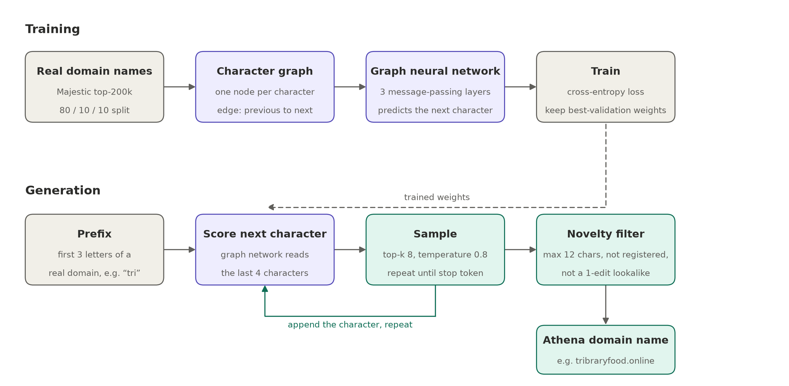

# Athena: an adversarial approach toward DGA classifiers

Athena is a character-level graph neural network that learns the shape of legitimate domain names and
generates new ones. It is trained only on benign domains and never sees a single malware sample.

Against seven re-implemented DGA detectors published between 2019 and 2024, Athena's names are
classified as legitimate **98.2%** of the time. Real DGA traffic from the same test bench is classified
as legitimate 12.9% of the time, and CharBot, the strongest training-free evasion baseline, 70.6%.

| Source of names | Count | Mean evasion across 7 classifiers |
|---|---|---|
| Real DGA, 50 UMUDGA families | 35,000 | 12.9% |
| CharBot (Peck et al., 2019) | 30,000 | 70.6% |
| Athena (this work) | 35,000 | **98.2%** |

Evasion is the share of generated names scored below 0.5, meaning the classifier called them benign.

## Framework



Each domain label is a chain graph with one node per character and one edge from each position to the
next. Three message-passing layers give the readout a four-character receptive field, and the model is
trained on next-character cross-entropy. To generate, Athena takes the first three characters of a real
domain as a prefix and extends it one character at a time, sampling from the eight most likely
continuations at temperature 0.8. A name is kept only if it is at most 12 characters, is absent from
the training corpus, and is not one edit away from any corpus label, so nothing is won by echoing a
real site.

## Why it works

Lexical DGA detectors learned the rule "random-looking means malicious". A character-level Shapley
analysis over 500 names shows them keying on rare consonant pairs such as `qe`, `jk`, `rw` and `xm` for
a DGA verdict, and on common English fragments such as `ing`, `ent`, `art` and `la` for a benign one.
Classic DGAs optimise for unpredictability, which produces exactly the first pattern. Athena optimises
for ordinariness, which produces the second. The detectors are not being tricked by a crafted
perturbation; they are being shown the evidence they were trained to treat as safe.

This also explains the gap to CharBot. CharBot perturbs a benign name and leaves a signature, so the
adversarially trained Integrated-DL model catches it 63.3% of the time. Athena generates a name that is
benign-looking to begin with, and the same model catches it 1.3% of the time.

## Results

Full numbers, figures and per-name scores are in
[`pipeline/ATHENA_COMBINED_REPORT.md`](pipeline/ATHENA_COMBINED_REPORT.md). A formatted summary is in
[`Athena_Report.pdf`](Athena_Report.pdf).

| Classifier | Real DGA detected | Athena detected | Athena evasion | AUC Athena vs legit |
|---|---|---|---|---|
| n-CBDC | 94.7% | 1.0% | 99.0% | 0.421 |
| MaldomDetector | 71.2% | 4.3% | 95.7% | 0.502 |
| ATT-CNN-BiLSTM | 95.0% | 0.9% | 99.1% | 0.418 |
| NGram-KL-Jaccard | 87.2% | 1.7% | 98.3% | 0.440 |
| LA-LSTM-Attention | 95.4% | 1.1% | 98.9% | 0.412 |
| Integrated-DL | 94.7% | 1.3% | 98.7% | 0.348 |
| HDDN * | 71.2% | 2.4% | 97.6% | 0.346 |

Every AUC for Athena against legitimate traffic is below 0.5, so the classifiers rank Athena names as
more benign than real benign domains. No threshold choice recovers detection.

Athena also out-evades all 50 real DGA families individually. The closest, the dictionary-based
*nymaim*, reaches 66.0%.

Two further experiments are included. A zero-day test retrains each classifier with ten families held
out, and recall falls from about 92% on seen families to 64–70% on unseen ones. An explainability pass
produces Shapley, integrated-gradients and attention attributions for all seven models.

## Repository layout

```
Athena_GNN.py              Athena generator: model, training, sampling
Athena_Report.pdf          formatted summary of the framework and results
dga_classifier/            the seven detectors, shared training and evaluation code
  01_n-CBDC/ ... 07_HDDN/  one folder per model
  common/                  datasets, features, layers, training loop, scorers, XAI
  experiments/             unseen-family (zero-day) experiment
  xai/                     Shapley, integrated gradients, attention
baselines/                 CharBot, MaskDGA, DeepDGA, Khaos re-implementations
pipeline/                  Athena vs classifiers, DGA comparison, figures, reports
  out_35k/                 the 35,000-name run
  charbot_vs_athena/       baseline comparison
  paper/                   publication figures and the results section
```

## Setup

```bash
pip install -r requirements.txt
```

Python 3.9 or newer. Everything runs on CPU.

### Data

Corpora are not committed, since they are large and separately licensed. Two are needed:

- **UMUDGA** (Zago, Gil Pérez, Martínez Pérez, University of Murcia, 2020; Mendeley Data
  `10.17632/y8ph45msv8.1`). Place the per-family lists in `dga_classifier/data/umudga/`.
- **Majestic Million**, top 200k labels, in `data/majestic/domains_200k.txt`.

### Reproduce

```bash
python Athena_GNN.py                              # train Athena, write synthetic names
python dga_classifier/compare.py                  # train all 7 detectors (CPU, 1-2 hours)
python pipeline/run_pipeline.py --n 35000         # Athena vs the 7 classifiers
python pipeline/compare_dga_athena.py             # real DGA vs Athena
python baselines/train_all.py                     # CharBot, MaskDGA, DeepDGA, Khaos
python pipeline/compare_charbot_athena.py         # baseline comparison
python dga_classifier/xai/run_xai.py              # explainability
python pipeline/paper_figures.py                  # figures
```

Add `--quick` to the training scripts for a smoke test. Every run is seeded.

## Limitations

These matter for reading the numbers, and are stated in full in the report.

- The seven classifiers are **reconstructions from the published descriptions**, not the original
  authors' code. Layer sizes and feature details are approximations, so absolute numbers will not match
  the papers. The comparison between models, and between name sources on the same model, is the
  meaningful part.
- `*` **HDDN** was scored on preliminary smoke-test weights during the 35,000-name run. Its fully
  trained model reaches F1 0.9661 on the full UMUDGA test set. Refreshing that row does not change the
  ranking or the conclusion, but the row should be re-run before publication.
- Each experiment used a single random seed.
- Khaos is approximated: the IEEE TIFS full text is not open access, so exact layer sizes are not
  published and a standard token WGAN-GP stands in.
- Evasion is measured on the domain name alone. This is not a claim that Athena would survive a
  network-level or registration-level defence, which is precisely the defence the result argues for.

## Implication

Lexical-only DGA detection is not sufficient against a learning-based generator. A detector that reads
the string alone can always be met by a generator that matches benign string statistics. Defence needs
signals a name generator does not control: NXDOMAIN behaviour, resolution and hosting graphs,
registration metadata, and first-contact characteristics.

## Intended use

Athena is a measurement instrument for red-team and detector-evaluation work. It is a name generator
only. It contains no command-and-control logic, no registration code and no delivery mechanism, and it
generates names that are deliberately filtered to avoid impersonating existing sites. It is published
so that defenders can test detectors against a realistic adversary rather than against the DGA families
those detectors were already trained on.

## References

| Model | Paper |
|---|---|
| n-CBDC | Xu, Shen, Du, *Computers & Security* 85 (2019) |
| MaldomDetector | Almashhadani et al., *Computers & Security* 93 (2020) |
| ATT-CNN-BiLSTM | Ren et al., *Cybersecurity* 3 (2020) |
| NGram-KL-Jaccard | Cucchiarelli et al., *Expert Systems with Applications* 170 (2021) |
| LA-LSTM-Attention | Tuan, Long, Taniar, *Computers & Security* 113 (2022) |
| Integrated-DL | Ravi et al., *IEEE Trans. Engineering Management* 70(1) (2023) |
| HDDN | Hybrid DGA DefenseNet, *Computers & Security* (2024) |
| CharBot | Peck et al., *IEEE Access* (2019), arXiv:1905.01078 |
| MaskDGA | Sidi et al. (2019), arXiv:1902.08909 |
| DeepDGA | Anderson et al., *AISec* (2016), arXiv:1610.01969 |
| Khaos | Yun et al., *IEEE TIFS* (2020) |

Dataset: Zago, M., Gil Pérez, M., Martínez Pérez, G. "UMUDGA: A dataset for profiling algorithmically
generated domain names in botnet detection." *Data in Brief* 30 (2020).
