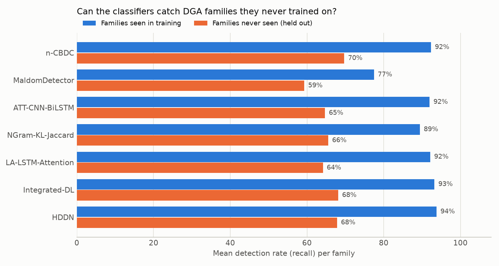
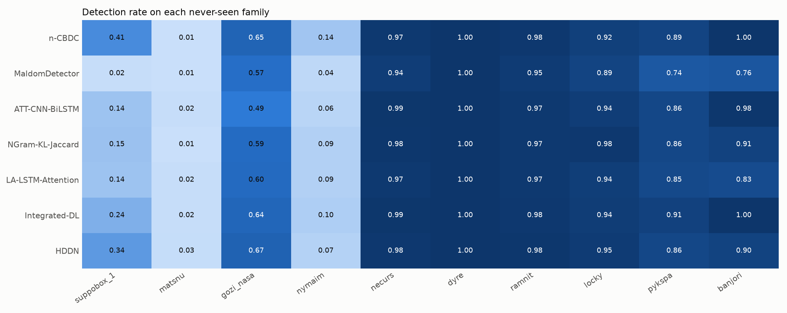
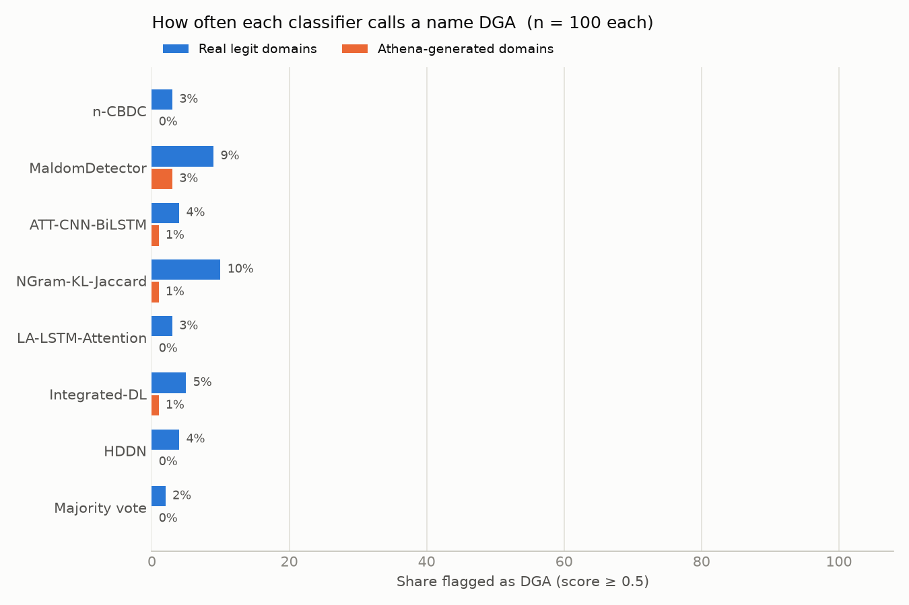
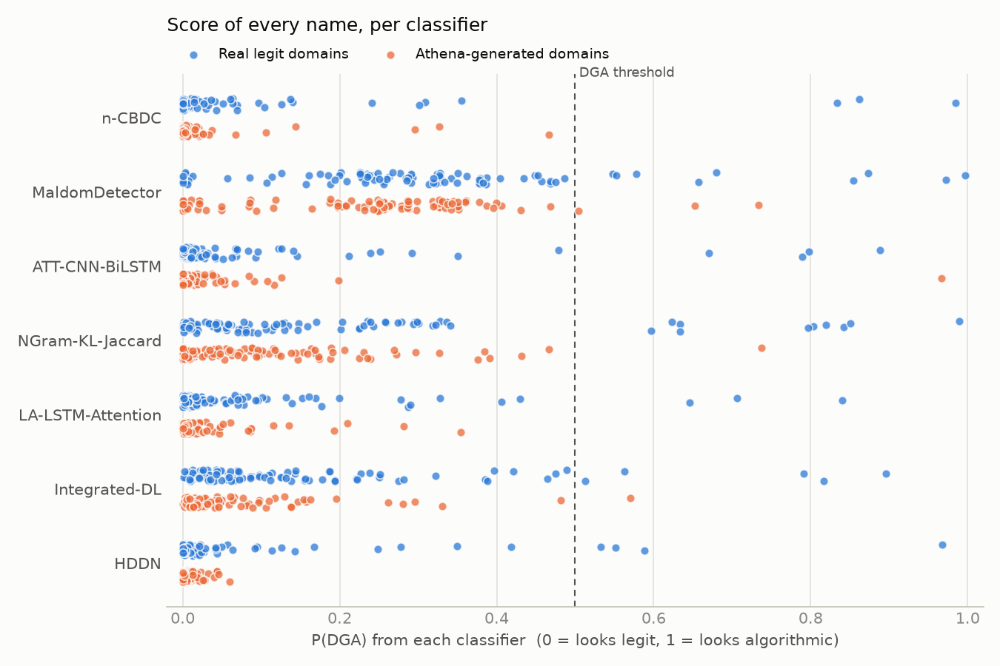
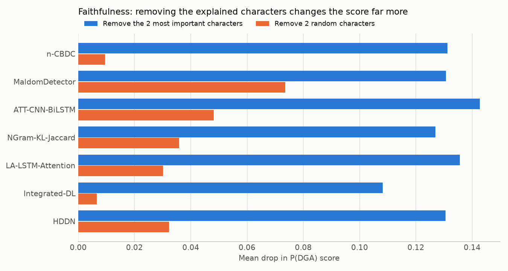
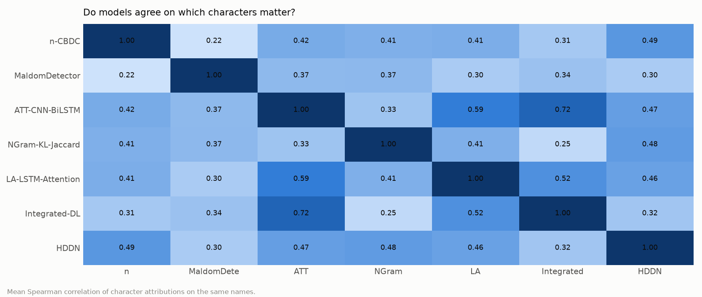
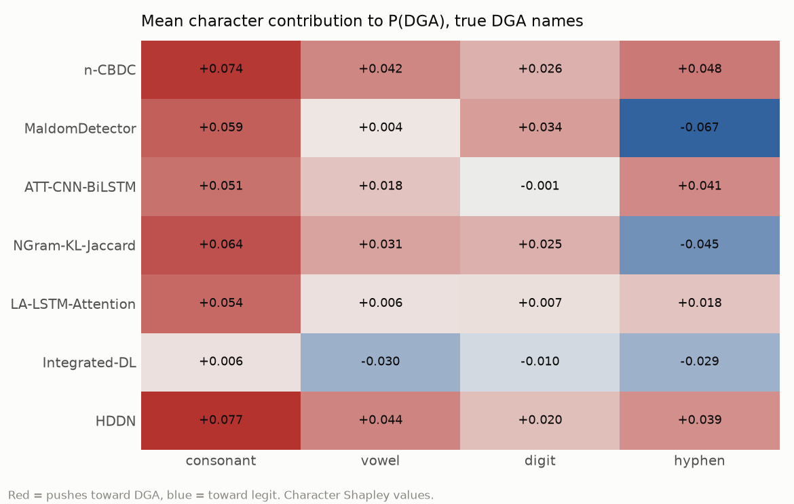
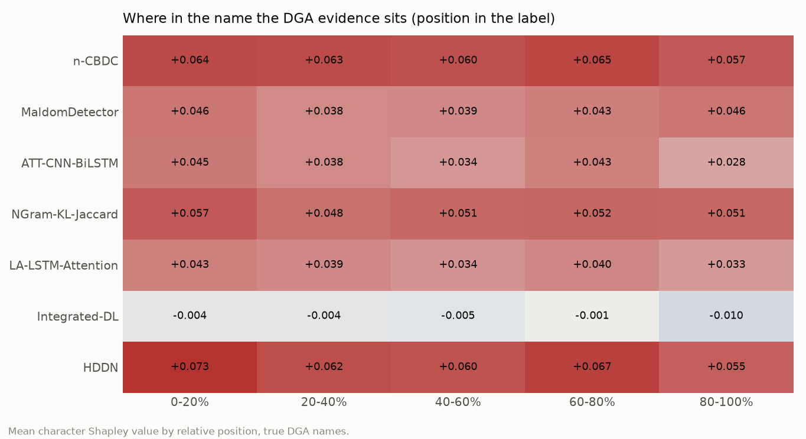

# DGA classifiers on full UMUDGA, with XAI and Athena: final report

Generated 2026-11-24 23:07.

## 1. Full-UMUDGA results (7 classifiers)

| Model | Type | F1 (10k lists) | **F1 (full UMUDGA)** | ROC-AUC | FPR | CharBot det. | Training names seen | Train time |
|---|---|---|---|---|---|---|---|---|
| n-CBDC | n-gram + CNN | 0.9309 | **0.9572** | 0.9919 | 3.16% | 21% | 4,800,000 | 59 min |
| MaldomDetector | 12 lexical features + random forest | 0.8299 | **0.7878** | 0.8894 | 9.47% | 24% | 500,000 | 2 min |
| ATT-CNN-BiLSTM | CNN + BiLSTM + attention | 0.9377 | **0.9564** | 0.9914 | 3.55% | 20% | 4,800,000 | 61 min |
| NGram-KL-Jaccard | 2/3-gram KL divergence + Jaccard + random forest | 0.9049 | **0.9003** | 0.9652 | 6.29% | 26% | 500,000 | 4 min |
| LA-LSTM-Attention | LSTM + attention | 0.9295 | **0.9520** | 0.9900 | 4.78% | 24% | 4,800,000 | 48 min |
| Integrated-DL | CNN || BiLSTM fusion + adversarial training | 0.9250 | **0.9507** | 0.9882 | 4.37% | 61% | 5,280,000 | 83 min |
| HDDN | FastText-style subwords + CNN + LSTM | 0.9403 | **0.9661** | 0.9948 | 2.73% | 21% | 4,800,000 | 92 min |

Best F1 on full UMUDGA: **HDDN** (0.9661). Test set: 100,000 held-out DGA names (2,000 from each of 50 families) + 100,000 held-out legit names. Full table: `results.md`.

**Family classification** (LA-LSTM-Attention, 51 classes): accuracy 0.8229, macro-F1 0.6705.

Hardest families (lowest recall) per model:

- n-CBDC: nymaim 0.47, symmi 0.81, matsnu 0.83, suppobox_2 0.86, proslikefan 0.87
- MaldomDetector: vawtrak_v2 0.00, vawtrak_v3 0.02, suppobox_2 0.05, suppobox_1 0.09, pizd 0.10
- ATT-CNN-BiLSTM: nymaim 0.54, symmi 0.78, matsnu 0.86, gozi_rfc4343 0.88, simda 0.88
- NGram-KL-Jaccard: suppobox_2 0.12, nymaim 0.21, pizd 0.44, suppobox_1 0.49, matsnu 0.51
- LA-LSTM-Attention: nymaim 0.57, symmi 0.81, matsnu 0.84, proslikefan 0.88, gozi_rfc4343 0.89
- Integrated-DL: nymaim 0.46, symmi 0.76, matsnu 0.81, gozi_rfc4343 0.87, suppobox_2 0.88
- HDDN: nymaim 0.58, symmi 0.81, matsnu 0.87, proslikefan 0.91, kraken_v1 0.92

## 2. Unseen-family (zero-day) experiment

Each classifier was retrained on the 10k-list data **without** these 10 families: suppobox_1, matsnu, gozi_nasa, nymaim, necurs, dyre, ramnit, locky, pykspa, banjori. It was then tested on all families. This shows how well a detector generalises to new malware it has never seen (zero-day DGAs).

| Model | Recall: seen families | Recall: unseen families | Gap | FPR on legit | ROC-AUC (all) |
|---|---|---|---|---|---|
| n-CBDC | 92.3% | 69.7% | +22.6 pts | 4.8% | 0.9554 |
| MaldomDetector | 77.5% | 59.3% | +18.1 pts | 5.8% | 0.9027 |
| ATT-CNN-BiLSTM | 92.0% | 64.7% | +27.3 pts | 2.7% | 0.9591 |
| NGram-KL-Jaccard | 89.4% | 65.6% | +23.9 pts | 4.5% | 0.9503 |
| LA-LSTM-Attention | 92.1% | 64.1% | +28.0 pts | 3.4% | 0.9540 |
| Integrated-DL | 93.2% | 68.2% | +25.1 pts | 5.1% | 0.9604 |
| HDDN | 93.8% | 67.8% | +25.9 pts | 4.1% | 0.9592 |

Best on unseen families: **n-CBDC** (69.7%).

Note: trained on the 10k-list data (2,000 names per family), not the full UMUDGA run, to fit the time budget.

## 3. Athena vs the classifiers (evasion)

| Model | Real legit flagged as DGA (false positives) | Athena flagged as DGA | Athena evasion rate | Mean score: legit | Mean score: Athena | Median score: Athena |
|---|---|---|---|---|---|---|
| n-CBDC | 3% | 0% | **100%** | 0.054 | 0.018 | 0.001 |
| MaldomDetector | 9% | 3% | **97%** | 0.273 | 0.239 | 0.256 |
| ATT-CNN-BiLSTM | 4% | 1% | **99%** | 0.069 | 0.026 | 0.004 |
| NGram-KL-Jaccard | 10% | 1% | **99%** | 0.170 | 0.104 | 0.063 |
| LA-LSTM-Attention | 3% | 0% | **100%** | 0.073 | 0.027 | 0.009 |
| Integrated-DL | 5% | 1% | **99%** | 0.139 | 0.059 | 0.022 |
| HDDN | 4% | 0% | **100%** | 0.054 | 0.007 | 0.002 |
| Majority vote | 2% | 0% | **100%** | - | - | - |

- Real legit names flagged = the classifier's **false-positive rate** on this sample.
- Athena names flagged = how often a classifier thinks an Athena name looks algorithmically generated.
- Evasion rate = 100% minus Athena flagged: the share of Athena names the classifier treats as legit. Compare it with the false-positive rate: if a classifier flags Athena names about as often as real legit names, it cannot tell them apart.
- Most suspicious of Athena: **MaldomDetector** (3%). Least: **n-CBDC** (0%).
- Majority vote flags 0% of Athena names vs 2% of real legit names.

## 4. Explainability (XAI)

| Model | Drop: top-2 chars | Drop: random-2 | Shapley vs IG (Spearman) | |Shapley| vs attention |
|---|---|---|---|---|
| n-CBDC | +0.131 | +0.009 | 0.20 | - |
| MaldomDetector | +0.131 | +0.074 | - | - |
| ATT-CNN-BiLSTM | +0.143 | +0.048 | 0.15 | 0.01 |
| NGram-KL-Jaccard | +0.127 | +0.036 | - | - |
| LA-LSTM-Attention | +0.136 | +0.030 | 0.14 | 0.05 |
| Integrated-DL | +0.108 | +0.007 | 0.14 | - |
| HDDN | +0.131 | +0.032 | 0.22 | - |

### Character n-grams pushing hardest toward DGA / toward legit

| Model | Toward DGA (true DGA names) | Toward legit (true legit names) |
|---|---|---|
| n-CBDC | `ab`, `eo`, `sur`, `wg`, `qe`, `fi`, `py`, `aw` | `tra`, `tor`, `ls`, `vin`, `ent`, `nl`, `sto`, `art` |
| MaldomDetector | `mt`, `mx`, `jk`, `hy`, `bx`, `gt`, `tq`, `dc` | `ee`, `bu`, `ou`, `ha`, `sa`, `so`, `it`, `la` |
| ATT-CNN-BiLSTM | `aw`, `ab`, `jk`, `tr`, `py`, `rw`, `gw`, `mb` | `ate`, `ah`, `ing`, `ran`, `el`, `mu`, `ara`, `ul` |
| NGram-KL-Jaccard | `py`, `qa`, `ff`, `rw`, `gt`, `qe`, `xm`, `yx` | `ort`, `il`, `ing`, `vin`, `nl`, `ara`, `ik`, `ar` |
| LA-LSTM-Attention | `ff`, `aw`, `rw`, `qa`, `wg`, `qe`, `gv`, `wi` | `vin`, `ran`, `ort`, `ara`, `ing`, `nte`, `sto`, `in` |
| Integrated-DL | `rw`, `jk`, `qe`, `mx`, `gv`, `yx`, `hy`, `xm` | `ran`, `ara`, `mu`, `tra`, `ing`, `ul`, `art`, `ck` |
| HDDN | `aw`, `ab`, `rw`, `yt`, `py`, `yx`, `qa`, `xm` | `art`, `ing`, `el`, `est`, `are`, `ent`, `in`, `da` |

Full XAI report with per-name explanations: `xai/out/XAI_report.md`.

## 5. Limits

- The 7 models are reconstructions from the papers' abstracts, not the authors' code.
- 'Full UMUDGA': all 36M names were deduplicated and pooled (up to 300k per family kept as training pool); each model drew fresh samples from those pools every epoch within a CPU time budget, so no model saw every name.
- One seed per experiment. The unseen-family experiment used the 10k-list data to fit the time budget.
- Athena results use 100 names; differences of a few points are within noise.
