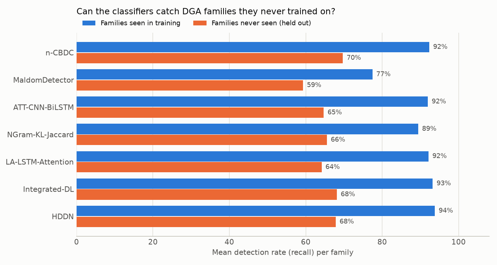
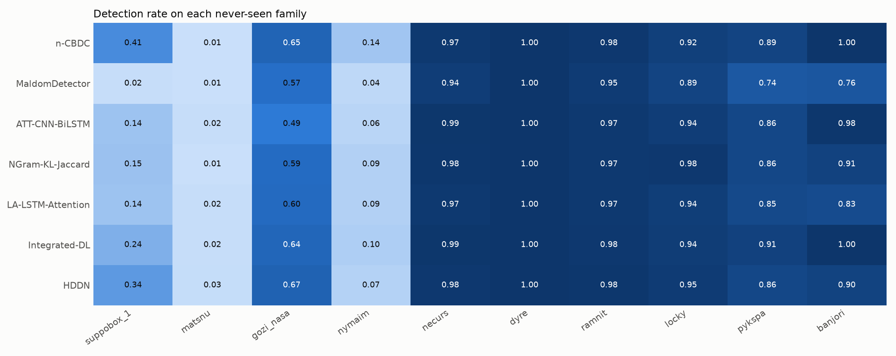

# Unseen-family experiment

Each classifier was retrained on the 10k-list data **without** these 10 families: suppobox_1, matsnu, gozi_nasa, nymaim, necurs, dyre, ramnit, locky, pykspa, banjori. It was then tested on all families. This shows how well a detector generalises to new malware it has never seen (zero-day DGAs).

| Model | Recall: seen families | Recall: unseen families | Gap | FPR on legit | ROC-AUC (all) |
|---|---|---|---|---|---|
| n-CBDC | 92.3% | 69.7% | +22.6 pts | 4.8% | 0.9554 |
| MaldomDetector | 77.5% | 59.3% | +18.1 pts | 5.8% | 0.9027 |
| ATT-CNN-BiLSTM | 92.0% | 64.7% | +27.3 pts | 2.7% | 0.9591 |
| NGram-KL-Jaccard | 89.4% | 65.6% | +23.9 pts | 4.5% | 0.9503 |
| LA-LSTM-Attention | 92.1% | 64.1% | +28.0 pts | 3.4% | 0.9540 |
| Integrated-DL | 93.2% | 68.2% | +25.1 pts | 5.1% | 0.9604 |
| HDDN | 93.8% | 67.8% | +25.9 pts | 4.1% | 0.9592 |

Best on unseen families: **n-CBDC** (69.7%).

Note: trained on the 10k-list data (2,000 names per family), not the full UMUDGA run, to fit the time budget.
