# XAI report: why the 7 DGA classifiers decide what they decide

500 names explained (200 DGA from 50 families, 200 legit, 100 Athena). Test split: `split.json`. Character Shapley with 16 permutations per name. Runtime 262s.

## Methods

- **Character Shapley (all 7 models):** each character's share of the P(DGA) score, by removing characters in random orders. Same method for neural and forest models, so explanations are comparable.
- **Integrated Gradients (5 neural models):** gradient-based attribution on the logit; used to cross-check Shapley.
- **Attention maps (03, 05):** the attention layer's weights, compared with |Shapley|.
- **Feature Shapley + permutation importance (02, 04):** which hand-made features drive the forests.
- **Deletion test:** delete the 2 most important characters vs 2 random ones. A faithful explanation causes a much larger score drop.

## Faithfulness and agreement

| Model | Drop: top-2 chars | Drop: random-2 | Shapley vs IG (Spearman) | |Shapley| vs attention |
|---|---|---|---|---|
| n-CBDC | +0.131 | +0.009 | 0.20 | - |
| MaldomDetector | +0.131 | +0.074 | - | - |
| ATT-CNN-BiLSTM | +0.143 | +0.048 | 0.15 | 0.01 |
| NGram-KL-Jaccard | +0.127 | +0.036 | - | - |
| LA-LSTM-Attention | +0.136 | +0.030 | 0.14 | 0.05 |
| Integrated-DL | +0.108 | +0.007 | 0.14 | - |
| HDDN | +0.131 | +0.032 | 0.22 | - |

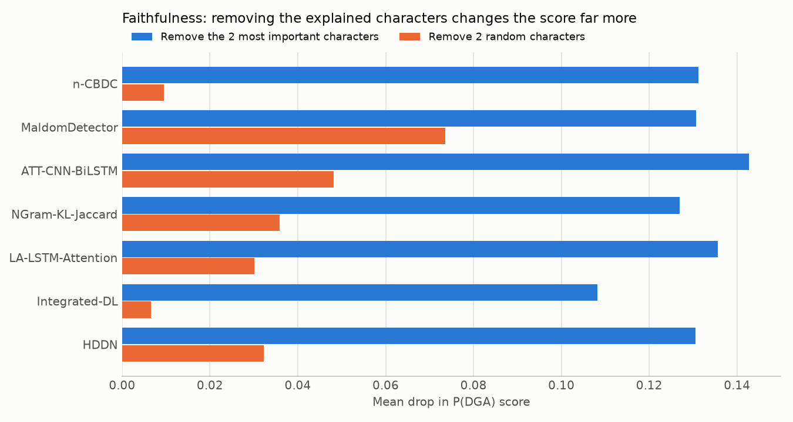

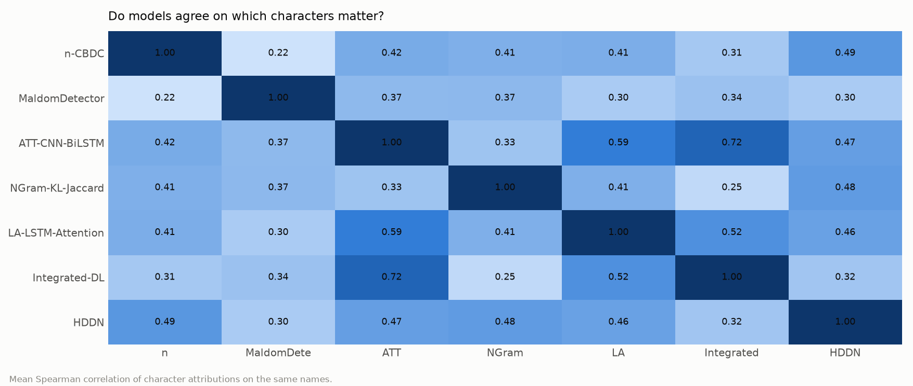

## What drives a DGA verdict

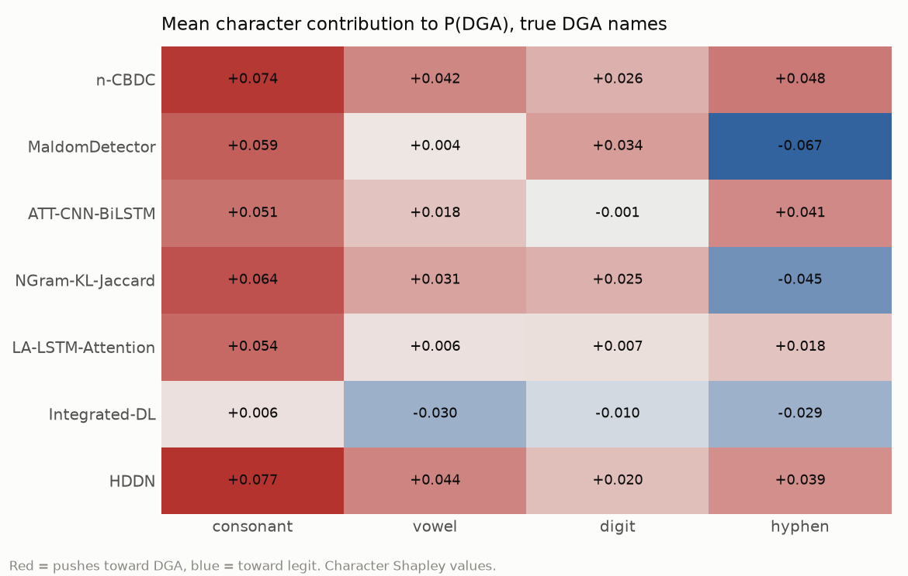

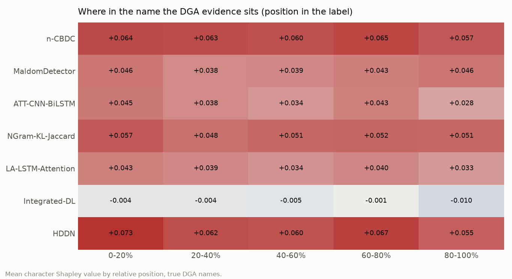

### Character n-grams pushing hardest toward DGA / toward legit

| Model | Toward DGA (true DGA names) | Toward legit (true legit names) |
|---|---|---|
| n-CBDC | `ab`, `eo`, `sur`, `wg`, `qe`, `fi`, `py`, `aw` | `tra`, `tor`, `ls`, `vin`, `ent`, `nl`, `sto`, `art` |
| MaldomDetector | `mt`, `mx`, `jk`, `hy`, `bx`, `gt`, `tq`, `dc` | `ee`, `bu`, `ou`, `ha`, `sa`, `so`, `it`, `la` |
| ATT-CNN-BiLSTM | `aw`, `ab`, `jk`, `tr`, `py`, `rw`, `gw`, `mb` | `ate`, `ah`, `ing`, `ran`, `el`, `mu`, `ara`, `ul` |
| NGram-KL-Jaccard | `py`, `qa`, `ff`, `rw`, `gt`, `qe`, `xm`, `yx` | `ort`, `il`, `ing`, `vin`, `nl`, `ara`, `ik`, `ar` |
| LA-LSTM-Attention | `ff`, `aw`, `rw`, `qa`, `wg`, `qe`, `gv`, `wi` | `vin`, `ran`, `ort`, `ara`, `ing`, `nte`, `sto`, `in` |
| Integrated-DL | `rw`, `jk`, `qe`, `mx`, `gv`, `yx`, `hy`, `xm` | `ran`, `ara`, `mu`, `tra`, `ing`, `ul`, `art`, `ck` |
| HDDN | `aw`, `ab`, `rw`, `yt`, `py`, `yx`, `qa`, `xm` | `art`, `ing`, `el`, `est`, `are`, `ent`, `in`, `da` |

## Forest models: feature importance

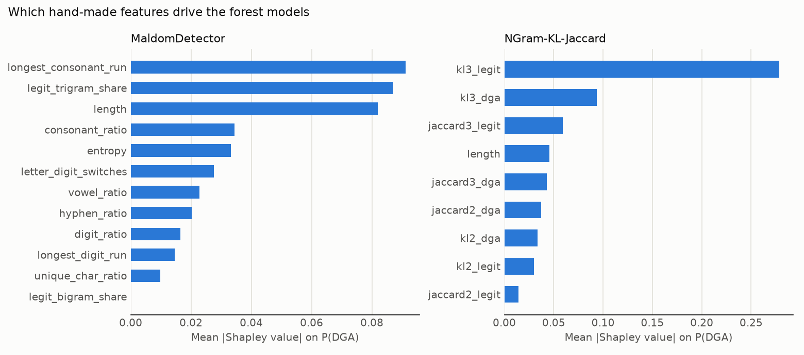

**MaldomDetector** - top features by mean |Shapley|: longest_consonant_run (0.091), legit_trigram_share (0.087), length (0.082), consonant_ratio (0.034), entropy (0.033). Permutation importance (AUC drop): longest_consonant_run (0.086), length (0.074), legit_trigram_share (0.068), hyphen_ratio (0.029), entropy (0.011).

**NGram-KL-Jaccard** - top features by mean |Shapley|: kl3_legit (0.278), kl3_dga (0.094), jaccard3_legit (0.059), length (0.045), jaccard3_dga (0.043). Permutation importance (AUC drop): kl3_legit (0.322), kl3_dga (0.068), length (0.024), jaccard3_legit (0.021), kl2_dga (0.017).

## Why Athena names look legit to the classifiers

| Model | Athena flagged | Legit flagged | n-grams pushing Athena names toward legit |
|---|---|---|---|
| n-CBDC | 0% | 2% | `la`, `an`, `ma`, `ent`, `en`, `ra`, `he`, `in` |
| MaldomDetector | 3% | 8% | `so`, `in`, `ing`, `ti`, `he`, `te`, `se`, `er` |
| ATT-CNN-BiLSTM | 1% | 3% | `ent`, `so`, `ing`, `in`, `sta`, `ts`, `ma`, `ce` |
| NGram-KL-Jaccard | 1% | 6% | `ing`, `in`, `ma`, `ur`, `la`, `ro`, `ou`, `ar` |
| LA-LSTM-Attention | 0% | 2% | `so`, `an`, `in`, `la`, `ent`, `ing`, `sta`, `ce` |
| Integrated-DL | 1% | 3% | `so`, `ent`, `sta`, `ing`, `an`, `ma`, `ce`, `in` |
| HDDN | 0% | 2% | `ing`, `in`, `la`, `so`, `te`, `bu`, `an`, `ti` |

## Example explanations

Each row is one model; red characters push toward DGA, blue toward legit.

**tudodebommermmo** (legit)

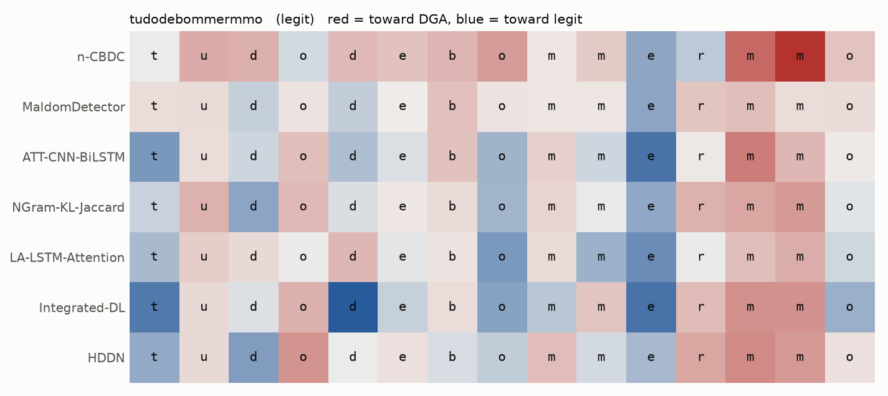

**anuncioscaracas** (legit)

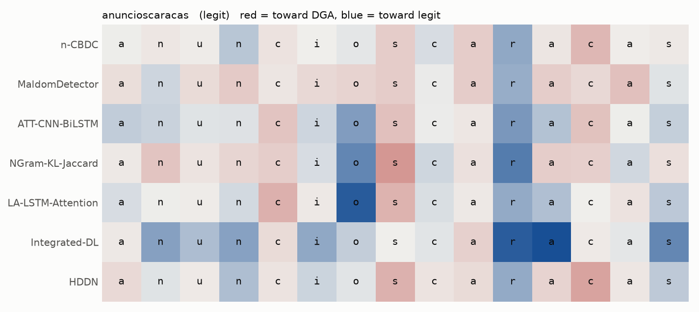

**stockbit** (legit)

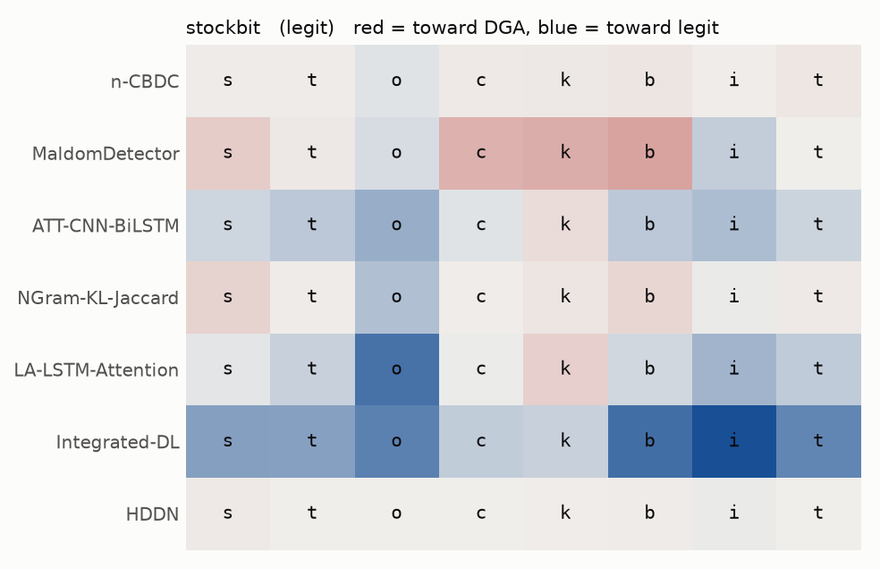

**spmdrggapa** (fobber_v2)

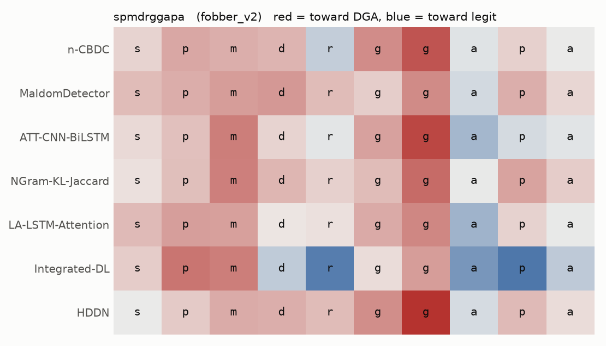

**sdapydsn** (vawtrak_v1)

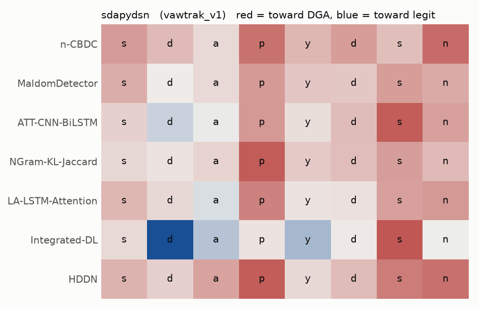

**ohpvciznhp** (alureon)

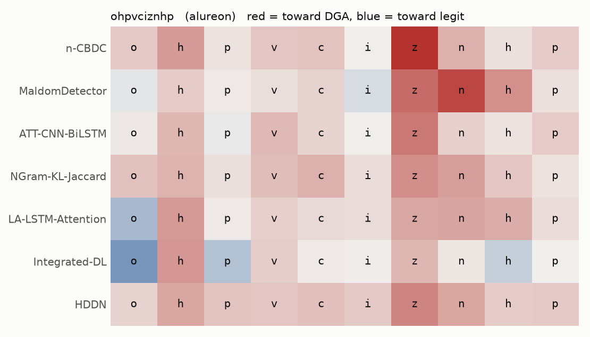

**s1lgct9xcq4c7wec** (chinad)

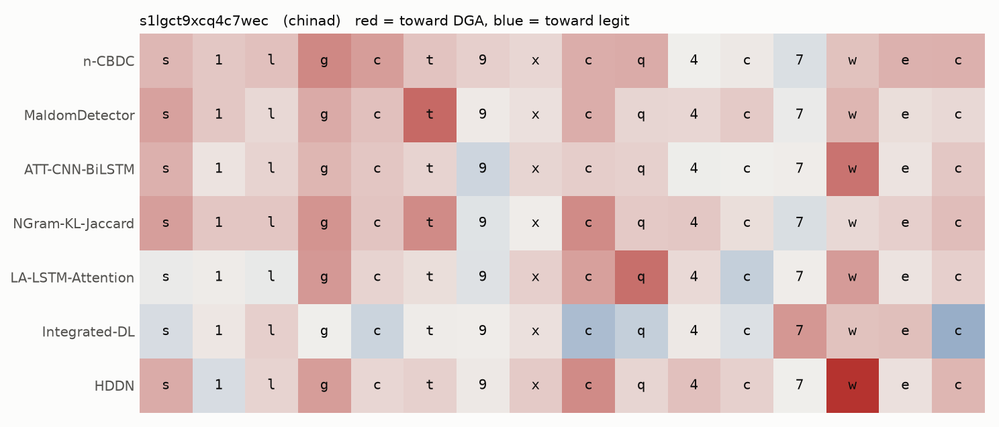

**copyaddressyourem** (gozi_gpl)

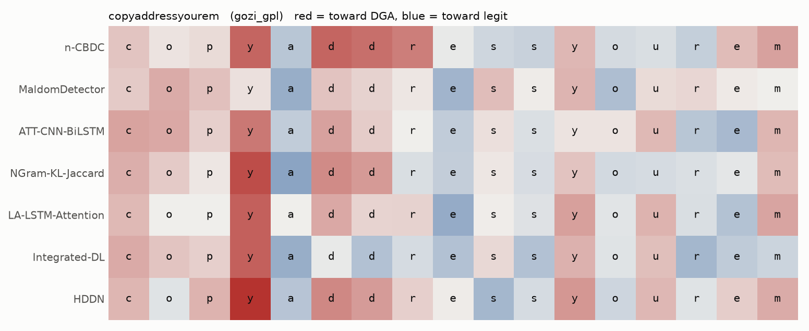

**hpljedsafe** (banjori)

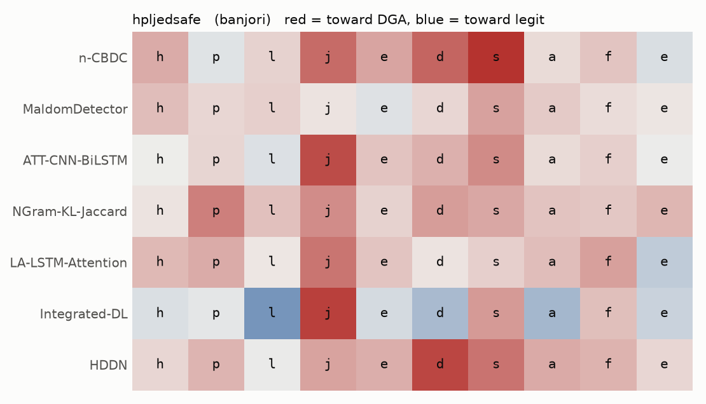

**talentainfa** (athena)

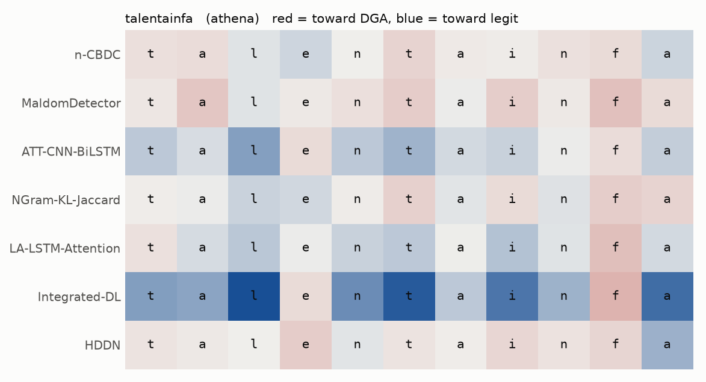

**processite** (athena)

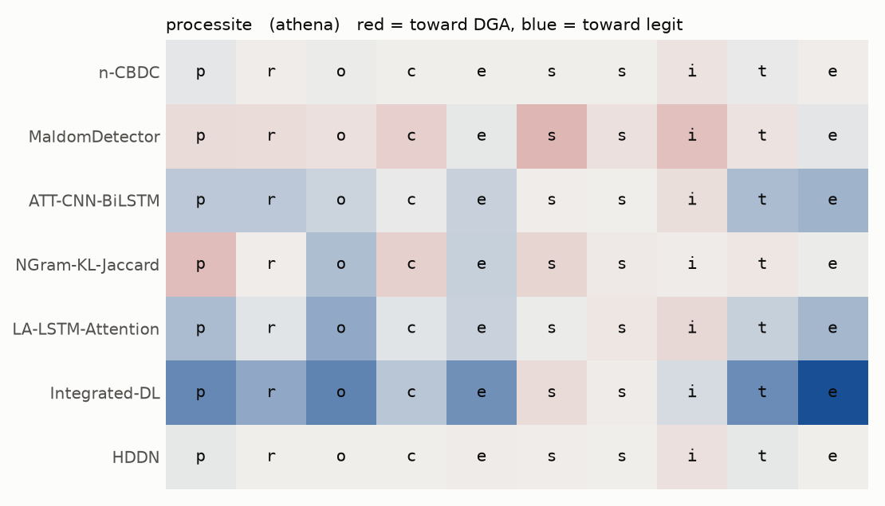

**yurenman** (athena)

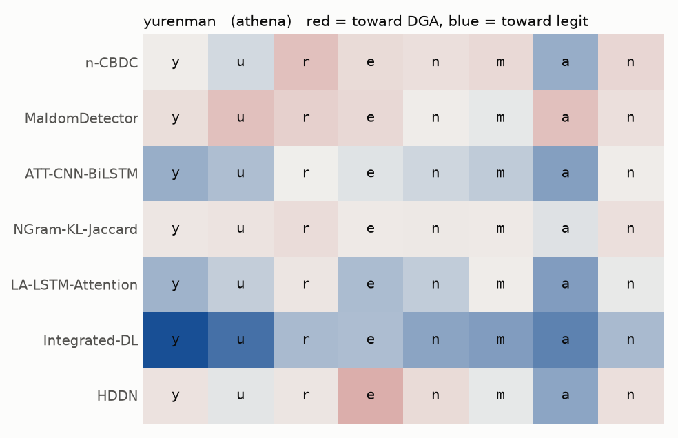

## Limits

- Shapley values here remove characters (the name gets shorter); other masking choices give somewhat different values. Integrated Gradients uses a zero-embedding baseline.
- Monte-Carlo estimates with a fixed seed; small values are noisy.
- Explanations describe these reconstructed models, not the original papers' code.
