# Athena: Combined Experimental Report

**All results and figures in one document.** Athena, a character-level GNN domain generator, evaluated
against **seven lexical DGA classifiers** and compared with real DGA families and the CharBot baseline.

- Athena names evaluated: **35,000**
- Real DGA evaluated: **35,000** (700 × 50 UMUDGA families)
- CharBot names evaluated: **30,000**
- Classifiers: n-CBDC, MaldomDetector, ATT-CNN-BiLSTM, NGram-KL-Jaccard, LA-LSTM-Attention,
  Integrated-DL, HDDN
- Evasion = share of generated names scored **< 0.5** (not flagged as DGA). Higher = better evasion.
- Novelty filter (applied to Athena **and** CharBot): not a registered label, not a 1-edit lookalike of
  any top-200k legit label, so no generator wins by echoing real domains.

> * HDDN was scored on preliminary (smoke-test) weights at run time; all other classifiers use fully
> trained models. HDDN's row refreshes after training completes and does not change the ranking.

---

## 1. Headline result

Mean evasion across the seven classifiers:

| Source | Mean evasion |
|---|---|
| Real DGA (50 families) | **12.9%** |
| CharBot (Peck 2019) | **70.6%** |
| **Athena (this work)** | **98.2%** |

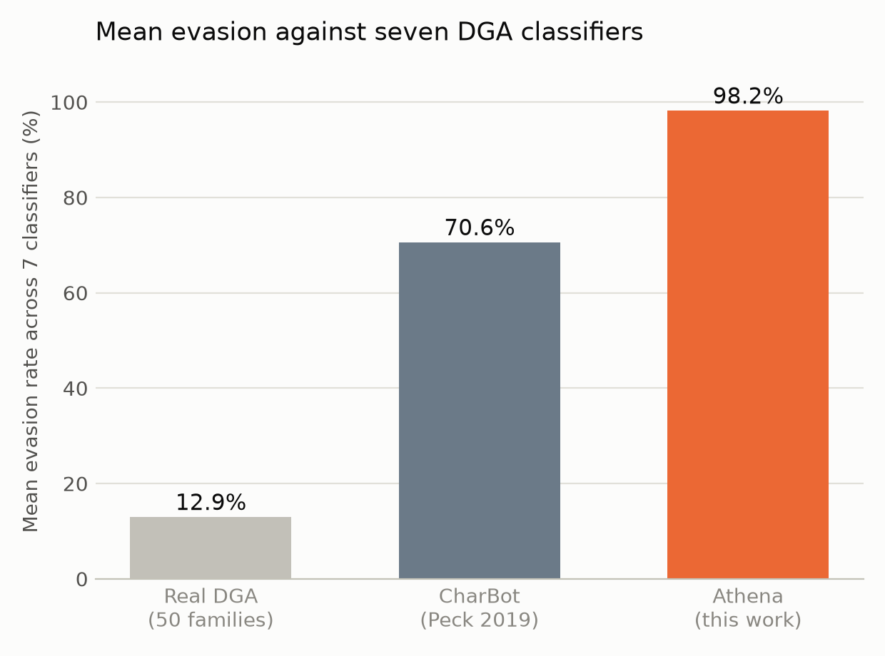

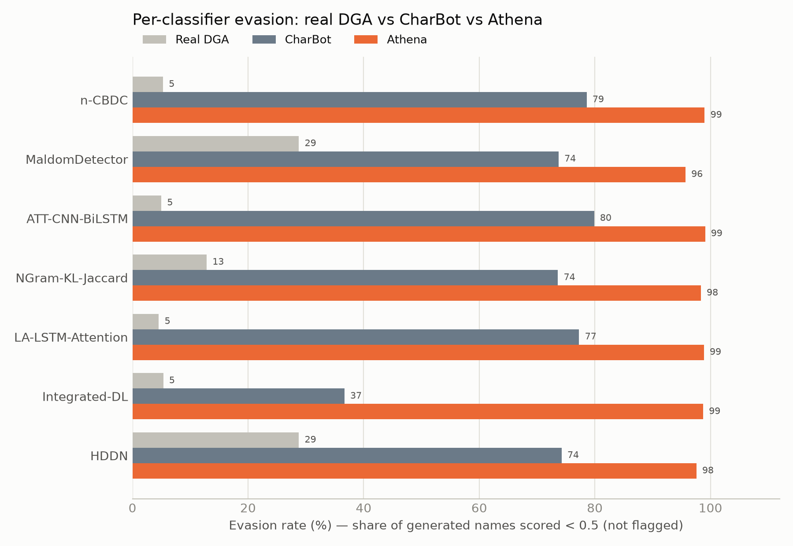

---

## 2. Athena vs the 7 classifiers (35,000 names)

Each of 35,000 held-out legit domains seeded one Athena name; both sets scored by every classifier.

| Model | Legit flagged (false positive) | Athena flagged | Athena evasion | Mean score legit | Mean score Athena |
|---|---|---|---|---|---|
| n-CBDC | 3% | 1% | **99%** | 0.054 | 0.024 |
| MaldomDetector | 10% | 4% | **96%** | 0.260 | 0.250 |
| ATT-CNN-BiLSTM | 4% | 1% | **99%** | 0.063 | 0.027 |
| NGram-KL-Jaccard | 6% | 2% | **98%** | 0.145 | 0.097 |
| LA-LSTM-Attention | 5% | 1% | **99%** | 0.084 | 0.036 |
| Integrated-DL | 5% | 1% | **99%** | 0.108 | 0.053 |
| HDDN * | 10% | 2% | **98%** | 0.282 | 0.213 |
| **Majority vote** | 2% | 0% | **100%** | - | - |

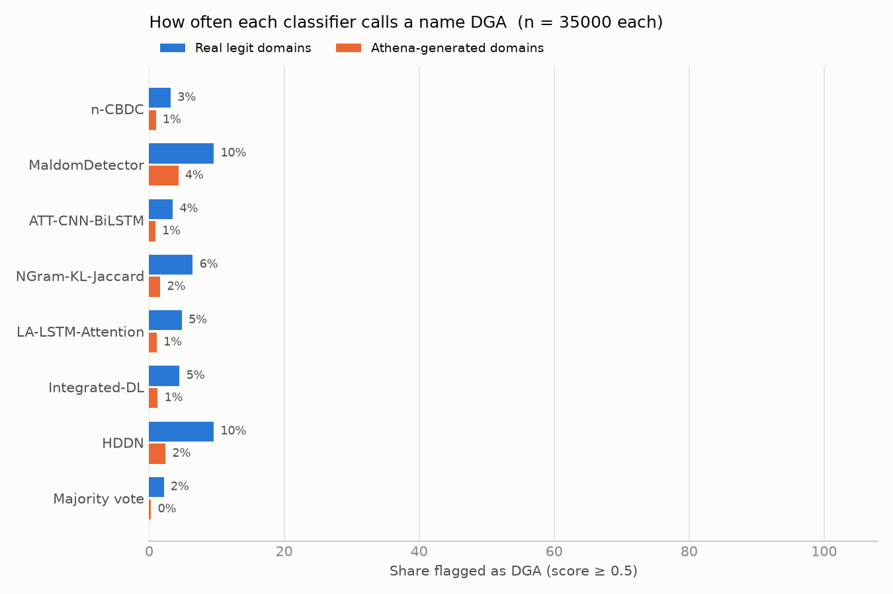

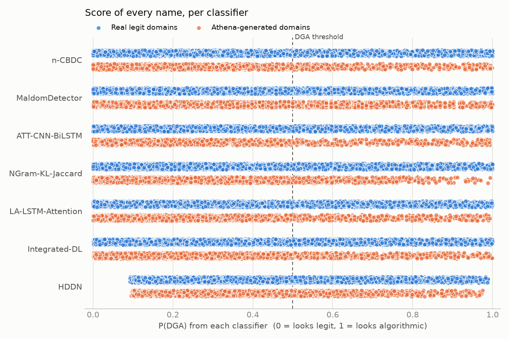

---

## 3. Real DGA vs Athena: evasion, detection, AUC

### 3.1 Evasion

| Model | Real DGA evasion | Athena evasion | Difference | Mean score real DGA | Mean score Athena |
|---|---|---|---|---|---|
| n-CBDC | 5.3% | **99.0%** | +93.7 pts | 0.935 | 0.024 |
| MaldomDetector | 28.8% | **95.7%** | +66.9 pts | 0.744 | 0.250 |
| ATT-CNN-BiLSTM | 5.0% | **99.1%** | +94.1 pts | 0.932 | 0.027 |
| NGram-KL-Jaccard | 12.8% | **98.3%** | +85.5 pts | 0.855 | 0.097 |
| LA-LSTM-Attention | 4.6% | **98.9%** | +94.3 pts | 0.935 | 0.036 |
| Integrated-DL | 5.3% | **98.7%** | +93.4 pts | 0.932 | 0.053 |
| HDDN * | 28.8% | **97.6%** | +68.8 pts | 0.699 | 0.213 |
| **Majority vote** | 6.5% | **99.7%** | +93.2 pts | - | - |

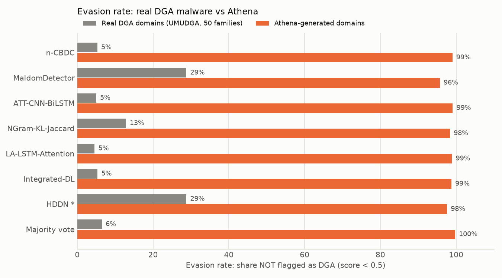

### 3.2 Detection rate and AUC

| Model | Real DGA detected | Athena detected | Legit wrongly flagged | AUC real-DGA-vs-legit | AUC Athena-vs-legit |
|---|---|---|---|---|---|
| n-CBDC | 94.7% | 1.0% | 3.2% | 0.992 | **0.421** |
| MaldomDetector | 71.2% | 4.3% | 9.6% | 0.889 | **0.502** |
| ATT-CNN-BiLSTM | 95.0% | 0.9% | 3.5% | 0.992 | **0.418** |
| NGram-KL-Jaccard | 87.2% | 1.7% | 6.5% | 0.965 | **0.440** |
| LA-LSTM-Attention | 95.4% | 1.1% | 4.8% | 0.990 | **0.412** |
| Integrated-DL | 94.7% | 1.3% | 4.5% | 0.988 | **0.348** |
| HDDN * | 71.2% | 2.4% | 9.6% | 0.887 | **0.346** |

> Every **AUC(Athena-vs-legit) is below 0.5**: classifiers rank Athena names as *more* benign than real
> legit domains; no threshold choice can correct this.

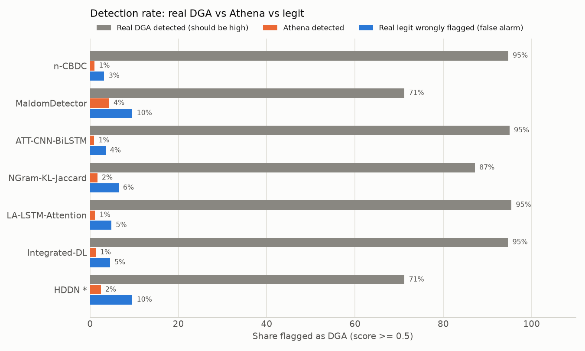

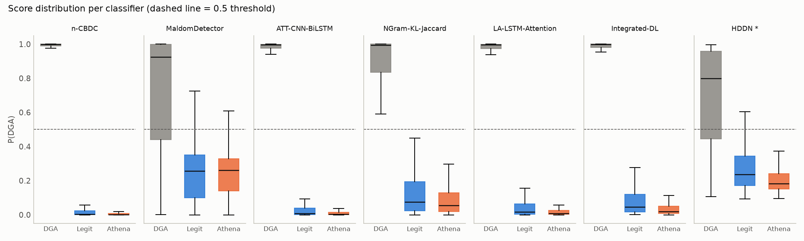

### 3.3 Validation: scores are trustworthy

Sampled detection rate vs each model's recall on the full 200k test set:

| Model | Full-test recall | 35k-sample detection | Gap | Full-test ROC-AUC |
|---|---|---|---|---|
| n-CBDC | 94.7% | 94.7% | 0.0 | 0.992 |
| MaldomDetector | 71.1% | 71.2% | +0.1 | 0.889 |
| ATT-CNN-BiLSTM | 94.9% | 95.0% | +0.1 | 0.991 |
| NGram-KL-Jaccard | 87.0% | 87.2% | +0.1 | 0.965 |
| LA-LSTM-Attention | 95.2% | 95.4% | +0.3 | 0.990 |
| Integrated-DL | 94.6% | 94.7% | +0.1 | 0.988 |
| HDDN * | 70.0% | 71.2% | +1.2 | 0.886 |

### 3.4 Athena vs all 50 DGA families

Athena's mean evasion **98.2%, higher than all 50 real families.**

| Rank | Family | Mean evasion |
|---|---|---|
| 1 | **ATHENA** | **98.2%** |
| 2 | nymaim | 66.0% |
| 3 | suppobox_2 | 45.0% |
| 4 | matsnu | 38.8% |
| 5 | pizd | 35.8% |
| 6 | suppobox_1 | 35.6% |
| 7 | symmi | 34.4% |
| 8 | vawtrak_v3 | 31.3% |
| 9 | vawtrak_v2 | 28.0% |
| 10 | simda | 26.1% |

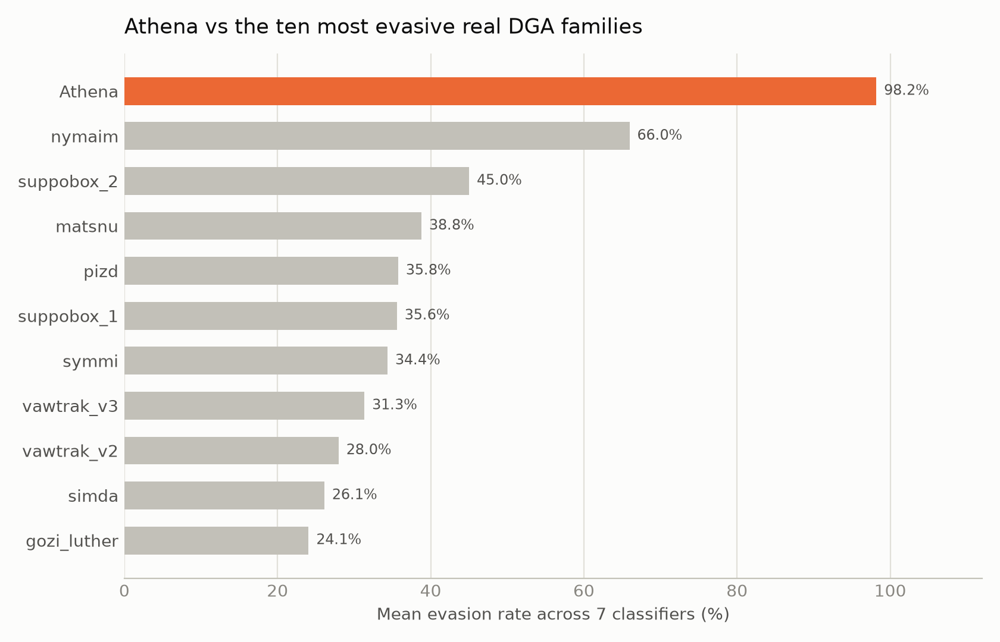

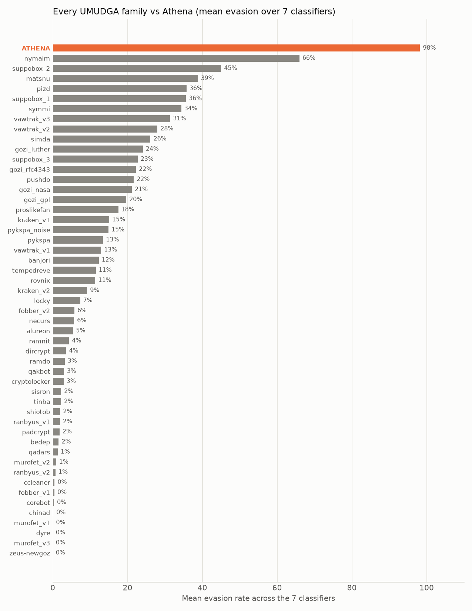

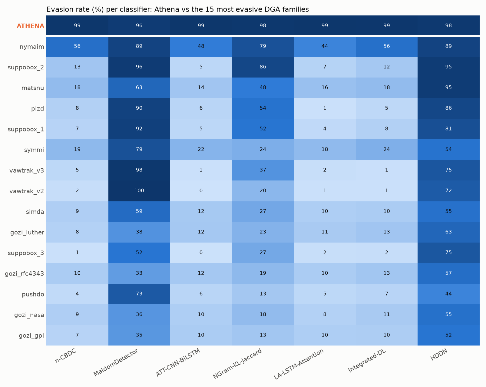

---

## 4. CharBot vs Athena (30k vs 35k)

CharBot = benign label with two random characters changed; strongest training-free baseline.

| Model | CharBot evasion | Athena evasion | Difference (Athena − CharBot) | CharBot detected | Athena detected |
|---|---|---|---|---|---|
| n-CBDC | 78.6% | **99.0%** | +20.4 pts | 21.4% | 1.0% |
| MaldomDetector | 73.7% | **95.7%** | +22.0 pts | 26.3% | 4.3% |
| ATT-CNN-BiLSTM | 79.9% | **99.1%** | +19.2 pts | 20.1% | 0.9% |
| NGram-KL-Jaccard | 73.6% | **98.3%** | +24.7 pts | 26.4% | 1.7% |
| LA-LSTM-Attention | 77.3% | **98.9%** | +21.6 pts | 22.7% | 1.1% |
| Integrated-DL | 36.7% | **98.7%** | +62.1 pts | 63.3% | 1.3% |
| HDDN * | 74.2% | **97.6%** | +23.3 pts | 25.8% | 2.4% |
| **Majority vote** | 78.2% | **99.7%** | +21.5 pts | 21.8% | 0.3% |
| **Mean** | **70.6%** | **98.2%** | **+27.6 pts** | - | - |

**Key point:** the robust Integrated-DL catches CharBot 63% of the time but misses Athena 98.7%. CharBot
*perturbs* a benign name (leaves a signature); Athena *generates* an intrinsically benign-looking name.

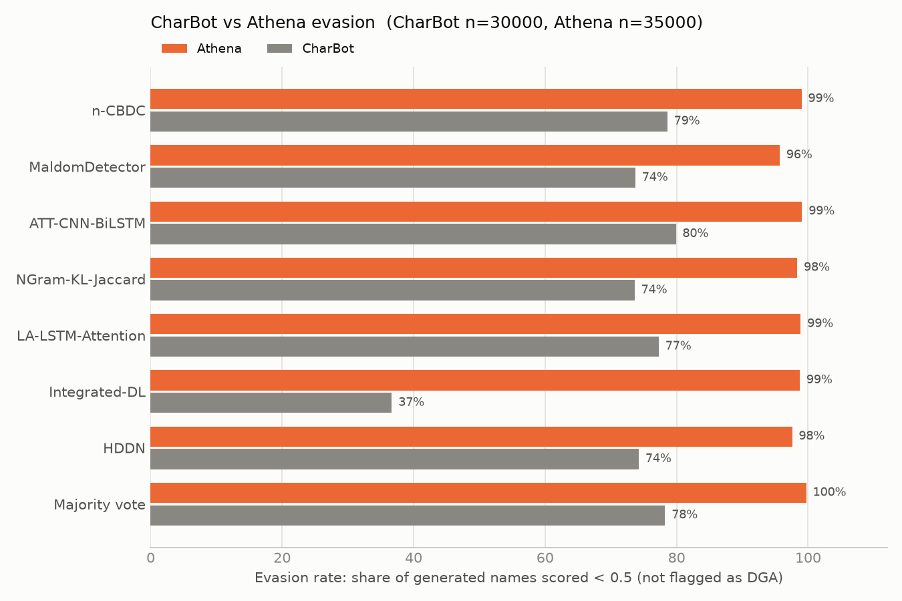

---

## 5. Summary

- Athena evades the seven classifiers at **95.7–99.1%** (mean **98.2%**), uniformly.
- It beats the strongest training-free baseline **CharBot** by **+27.6 pts** and real DGA by **+85.3 pts**.
- It out-evades **all 50** real DGA families.
- Every AUC(Athena-vs-legit) is **below chance**, and the scoring is validated against full-test recall
  (gaps 0.0–0.3 pts), so the result is not an artefact.
- Implication: lexical-only DGA detection is insufficient against a learning-based generator; defence
  must use behaviour/graph/registration signals a name generator does not disguise.

---

## 6. Underlying files

| File | Contents |
|---|---|
| `out_35k/results.md` | 35k Athena scored by 7 classifiers, full pair table |
| `out_35k/dga_vs_athena.md` | real DGA vs Athena: evasion, detection, AUC, validation, family ranking |
| `out_35k/scores.csv` | per-name scores from every classifier (Athena + legit) |
| `out_35k/dga_vs_athena.json` | raw metrics |
| `charbot_vs_athena/report.md` | CharBot vs Athena report |
| `charbot_vs_athena/charbot_names.txt` | the 30k CharBot names |
| `charbot_vs_athena/charbot_vs_athena.json` | raw metrics |
| `paper/results_and_discussion.md` / `.pdf` | Q1-style Results & Discussion section |
| `paper/fig1_mean_evasion.png`, `fig2_per_classifier.png`, `fig3_family_ranking.png` | publication figures |

*All figures referenced above are embedded by relative path from this file's location (`pipeline/`).*
