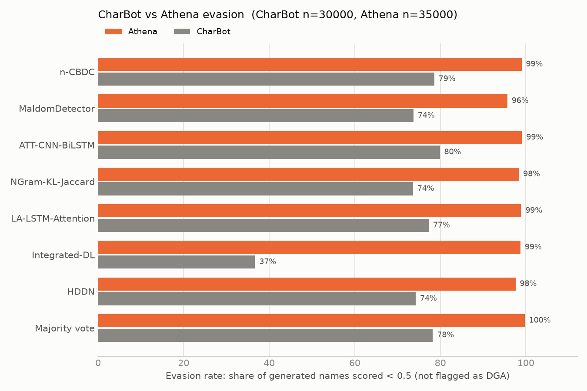

# CharBot vs Athena: evasion against the 7 DGA classifiers

Run: 2026-11-24 21:18 | seed 2026 | CharBot n=30000 | Athena n=35000 (from `out_35k/scores.csv`)

**CharBot** (Peck et al., IEEE Access 2019): take a benign Majestic-200k label and change two random characters; keep it only if it is novel and not a 1-edit lookalike of a known legit name, the exact same novelty bar Athena's names pass. No training, no knowledge of the target classifier.

Evasion = share of generated names scored **< 0.5** (treated as legit, i.e. the attack got through). Higher = better evasion.

## Evasion rate

| Model | CharBot evasion | Athena evasion | Difference (Athena − CharBot) | CharBot mean score | Athena mean score |
|---|---|---|---|---|---|
| n-CBDC | 78.6% | **99.0%** | +20.4 pts | 0.236 | 0.024 |
| MaldomDetector | 73.7% | **95.7%** | +22.0 pts | 0.330 | 0.250 |
| ATT-CNN-BiLSTM | 79.9% | **99.1%** | +19.2 pts | 0.228 | 0.027 |
| NGram-KL-Jaccard | 73.6% | **98.3%** | +24.7 pts | 0.316 | 0.097 |
| LA-LSTM-Attention | 77.3% | **98.9%** | +21.6 pts | 0.255 | 0.036 |
| Integrated-DL | 36.7% | **98.7%** | +62.1 pts | 0.627 | 0.053 |
| HDDN * | 74.2% | **97.6%** | +23.3 pts | 0.385 | 0.213 |
| Majority vote | 78.2% | **99.7%** | +21.5 pts | - | - |

## Detection rate (share flagged as DGA, score ≥ 0.5)

| Model | CharBot detected | Athena detected |
|---|---|---|
| n-CBDC | 21.4% | 1.0% |
| MaldomDetector | 26.3% | 4.3% |
| ATT-CNN-BiLSTM | 20.1% | 0.9% |
| NGram-KL-Jaccard | 26.4% | 1.7% |
| LA-LSTM-Attention | 22.7% | 1.1% |
| Integrated-DL | 63.3% | 1.3% |
| HDDN | 25.8% | 2.4% |
| Majority vote | 21.8% | 0.3% |

## Summary
- Mean evasion across the 7 classifiers: **CharBot 70.6%**, **Athena 98.2%**.
- Both are strong evaders, but Athena edges out CharBot by 27.6 pts on average.
- * marks a classifier still on smoke-test weights at run time.

CharBot names: `charbot_names.txt`. Per-model raw numbers: `charbot_vs_athena.json`.
