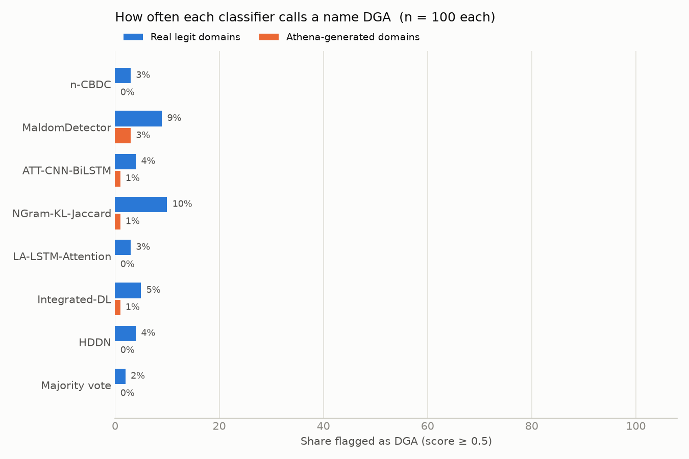
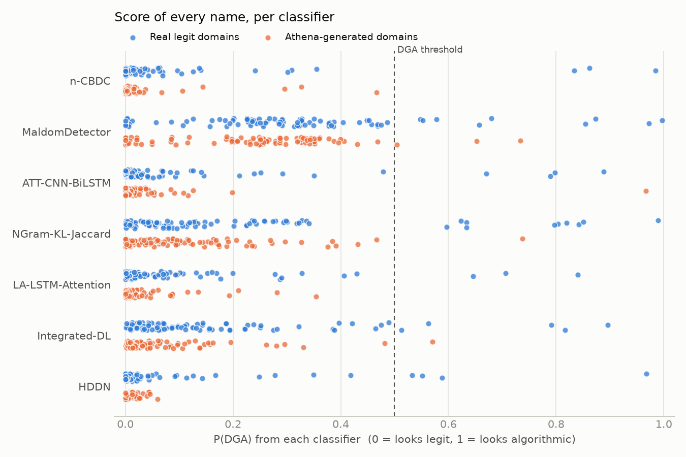

# Athena vs DGA classifiers

Run: 2026-11-24 23:02 | seed 2026 | 100 candidate pairs | 7 classifiers

## What was done
1. Picked 100 random legit domains from the classifiers' **held-out test split** (never seen in training).
2. Gave each to **Athena** as its candidate: the first 3 characters became the prefix, and Athena generated one new name (≤ 12 chars, temperature 0.8, top-k 8; rejects known names and one-edit lookalikes of the 200k Majestic list).
3. Scored both sets with every saved classifier (no retraining). A score ≥ 0.5 means "DGA".

## Results

| Model | Real legit flagged as DGA (false positives) | Athena flagged as DGA | Athena evasion rate | Mean score: legit | Mean score: Athena | Median score: Athena |
|---|---|---|---|---|---|---|
| n-CBDC | 3% | 0% | **100%** | 0.054 | 0.018 | 0.001 |
| MaldomDetector | 9% | 3% | **97%** | 0.273 | 0.239 | 0.256 |
| ATT-CNN-BiLSTM | 4% | 1% | **99%** | 0.069 | 0.026 | 0.004 |
| NGram-KL-Jaccard | 10% | 1% | **99%** | 0.170 | 0.104 | 0.063 |
| LA-LSTM-Attention | 3% | 0% | **100%** | 0.073 | 0.027 | 0.009 |
| Integrated-DL | 5% | 1% | **99%** | 0.139 | 0.059 | 0.022 |
| HDDN | 4% | 0% | **100%** | 0.054 | 0.007 | 0.002 |
| Majority vote | 2% | 0% | **100%** | - | - | - |

## Reading it
- Real legit names flagged = the classifier's **false-positive rate** on this sample.
- Athena names flagged = how often a classifier thinks an Athena name looks algorithmically generated.
- Evasion rate = 100% minus Athena flagged: the share of Athena names the classifier treats as legit. Compare it with the false-positive rate: if a classifier flags Athena names about as often as real legit names, it cannot tell them apart.
- Most suspicious of Athena: **MaldomDetector** (3%). Least: **n-CBDC** (0%).
- Majority vote flags 0% of Athena names vs 2% of real legit names.

## Athena names the classifiers found most DGA-like (top 10 by mean score)

| Athena domain | From legit | Mean score | Votes |
|---|---|---|---|
| publingoward.ai | pubg8x | 0.268 | 1/7 |
| krsburgs.site | krs999 | 0.240 | 1/7 |
| vibit-setlab.info | vibefun | 0.237 | 1/7 |
| k97kchoice.net | k973k | 0.196 | 1/7 |
| theferration.io | thequeenofthebeach | 0.185 | 1/7 |
| trendshor.com | trendblogexpress | 0.176 | 0/7 |
| pbuseplanna.info | pbusa | 0.152 | 0/7 |
| twfairs.online | twfotoart | 0.144 | 0/7 |
| xunbindo.net | xunsuexpress | 0.132 | 0/7 |
| tribraryfood.online | trickytime | 0.119 | 0/7 |

## All pairs

| # | Legit candidate | Prefix | Athena domain | Votes legit | Votes Athena |
|---|---|---|---|---|---|
| 1 | wonders-of-the-world | won | wonstudio.com | 0/7 | 0/7 |
| 2 | ppgpmc | ppg | ppgrid.net | 3/7 | 0/7 |
| 3 | 700xxx | 700 | 7001.org | 0/7 | 0/7 |
| 4 | gifer | gif | giffields.io | 0/7 | 0/7 |
| 5 | koppalpolice | kop | koproscience.co | 0/7 | 0/7 |
| 6 | raovatquynhon | rao | raomark.app | 2/7 | 0/7 |
| 7 | lebaobaoxian | leb | lebentoc.dev | 0/7 | 0/7 |
| 8 | myscrapnook | mys | mystan.xyz | 1/7 | 0/7 |
| 9 | mercurycards | mer | merankunds.online | 0/7 | 0/7 |
| 10 | shipped4me | shi | shirontent.site | 0/7 | 0/7 |
| 11 | vibefun | vib | vibit-setlab.info | 1/7 | 1/7 |
| 12 | pcforce | pcf | pcfesting.ai | 0/7 | 0/7 |
| 13 | wm114 | wm1 | wm1x.com | 0/7 | 0/7 |
| 14 | muenchner-kammerspiele | mue | muell.net | 0/7 | 0/7 |
| 15 | designfotografevi | des | deserency.org | 0/7 | 0/7 |
| 16 | celticsquad | cel | celeblog.io | 0/7 | 0/7 |
| 17 | harrisonlakehotel | har | harands.co | 0/7 | 0/7 |
| 18 | camwhorestv | cam | camarkill.app | 0/7 | 0/7 |
| 19 | casadasbets | cas | casino-fi.dev | 0/7 | 0/7 |
| 20 | visitarcostarica | vis | visionstates.xyz | 0/7 | 0/7 |
| 21 | riksettan | rik | rikino.online | 0/7 | 0/7 |
| 22 | nwhof | nwh | nwhitess.site | 0/7 | 0/7 |
| 23 | aariefr | aar | aarbures.info | 0/7 | 0/7 |
| 24 | myway | myw | mywols.ai | 0/7 | 0/7 |
| 25 | web-egy | web | webase.com | 0/7 | 0/7 |
| 26 | blackswanltd | bla | blacks.net | 1/7 | 0/7 |
| 27 | hozhack | hoz | hozenter.org | 0/7 | 0/7 |
| 28 | kabramkrafts | kab | kaboutdaily.io | 0/7 | 0/7 |
| 29 | subtorrents | sub | subasoft.co | 0/7 | 0/7 |
| 30 | blizzardguides | bli | blinghein.app | 0/7 | 0/7 |
| 31 | propianino | pro | processite.dev | 0/7 | 0/7 |
| 32 | filesetups | fil | filmstor.xyz | 0/7 | 0/7 |
| 33 | twfotoart | twf | twfairs.online | 1/7 | 0/7 |
| 34 | cycler-looper | cyc | cycloc.site | 0/7 | 0/7 |
| 35 | pbusa | pbu | pbuseplanna.info | 0/7 | 0/7 |
| 36 | pol-vre | pol | policytimes.ai | 0/7 | 0/7 |
| 37 | kokogvin | kok | koktramarin.com | 0/7 | 0/7 |
| 38 | k973k | k97 | k97kchoice.net | 0/7 | 1/7 |
| 39 | snmjournals | snm | snmrs.org | 2/7 | 0/7 |
| 40 | asada | asa | asaaraus.io | 0/7 | 0/7 |
| 41 | boulderstationsclv | bou | boutablab.co | 3/7 | 0/7 |
| 42 | sabrebondage | sab | saboutiftech.app | 0/7 | 0/7 |
| 43 | jcic | jci | jciences.dev | 0/7 | 0/7 |
| 44 | polirolka | pol | polspin.xyz | 0/7 | 0/7 |
| 45 | hermesjet | her | herabot.online | 0/7 | 0/7 |
| 46 | dangvanhungditim | dan | dankt.site | 0/7 | 0/7 |
| 47 | fluidable | flu | flutions.info | 0/7 | 0/7 |
| 48 | avecturf | ave | aversoftware.ai | 0/7 | 0/7 |
| 49 | tokyoyogashop | tok | tokare.com | 0/7 | 0/7 |
| 50 | peaceucc | pea | peartreeties.net | 2/7 | 0/7 |
| 51 | submitworker | sub | suburningweb.org | 0/7 | 0/7 |
| 52 | postpals | pos | possara.io | 0/7 | 0/7 |
| 53 | eic-av | eic | eicorner.co | 0/7 | 0/7 |
| 54 | pageantmedia | pag | pagency.app | 0/7 | 0/7 |
| 55 | educarparalohumano | edu | educational.dev | 0/7 | 1/7 |
| 56 | lovinglanguage | lov | lovetodesk.xyz | 0/7 | 0/7 |
| 57 | passatb3piter | pas | passpace.online | 1/7 | 0/7 |
| 58 | citizensnpcs | cit | cityanins.site | 3/7 | 0/7 |
| 59 | abuharira | abu | abushs.info | 0/7 | 0/7 |
| 60 | 3dczk | 3dc | 3dcap.ai | 0/7 | 0/7 |
| 61 | drmartensforlife | drm | drmania.com | 0/7 | 0/7 |
| 62 | uhcglobal | uhc | uhcra.net | 0/7 | 0/7 |
| 63 | desk360 | des | deservaton.org | 0/7 | 0/7 |
| 64 | fontforge | fon | fondhouse.io | 0/7 | 0/7 |
| 65 | tawjihpro | taw | tawards.co | 1/7 | 0/7 |
| 66 | dipawardhana | dip | dipcare.app | 0/7 | 0/7 |
| 67 | maxfer | max | maxani.dev | 0/7 | 0/7 |
| 68 | sport-komplekt | spo | sportsparks.xyz | 0/7 | 0/7 |
| 69 | cognitiveclass | cog | cogen-museum.online | 0/7 | 0/7 |
| 70 | southdaleeyeclinic | sou | southcards.site | 0/7 | 0/7 |
| 71 | invences | inv | inventarena.info | 0/7 | 0/7 |
| 72 | khatesefid | kha | khabank.ai | 0/7 | 0/7 |
| 73 | cbsenetonline | cbs | cbstesta.com | 0/7 | 0/7 |
| 74 | customvinylbybridgett | cus | customotory.net | 4/7 | 0/7 |
| 75 | cheatallgames | che | chemishers.org | 0/7 | 0/7 |
| 76 | footmarseillais | foo | foodbeats.io | 0/7 | 0/7 |
| 77 | ca7marriagess | ca7 | ca7soccer.co | 0/7 | 0/7 |
| 78 | yurilog | yur | yurenman.app | 0/7 | 0/7 |
| 79 | a2zcracks | a2z | a2zseonline.dev | 0/7 | 0/7 |
| 80 | palegis | pal | palace.xyz | 0/7 | 0/7 |
| 81 | trickytime | tri | tribraryfood.online | 0/7 | 0/7 |
| 82 | krs999 | krs | krsburgs.site | 0/7 | 1/7 |
| 83 | studyportalsapply | stu | stumments.info | 0/7 | 0/7 |
| 84 | pubg8x | pub | publingoward.ai | 1/7 | 1/7 |
| 85 | talentecosystems | tal | talentainfa.com | 1/7 | 0/7 |
| 86 | losalamosreporter | los | lostates.net | 1/7 | 0/7 |
| 87 | voskres | vos | vostingtong.org | 0/7 | 0/7 |
| 88 | thequeenofthebeach | the | theferration.io | 3/7 | 1/7 |
| 89 | heloisenonne | hel | hellstation.co | 0/7 | 0/7 |
| 90 | restwater | res | resinguide.app | 0/7 | 0/7 |
| 91 | diarioeningles4 | dia | diarhour.dev | 0/7 | 0/7 |
| 92 | drawfee | dra | draine.xyz | 0/7 | 0/7 |
| 93 | komoedie-hamburg | kom | kommance.online | 0/7 | 0/7 |
| 94 | eastporter | eas | eastats.site | 0/7 | 0/7 |
| 95 | growingschools | gro | grolmenster.info | 1/7 | 0/7 |
| 96 | shopstoddardsguns | sho | shophub.ai | 0/7 | 0/7 |
| 97 | trendblogexpress | tre | trendshor.com | 0/7 | 0/7 |
| 98 | xunsuexpress | xun | xunbindo.net | 0/7 | 0/7 |
| 99 | rosilva | ros | rosofts.org | 0/7 | 0/7 |
| 100 | yoelijomipc | yoe | yoer.io | 6/7 | 0/7 |

Per-model scores for every name: `scores.csv`. TLDs on Athena names are added for display only; classifiers score the name before the TLD.
