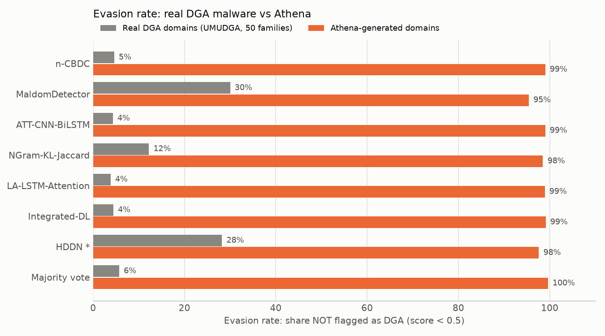
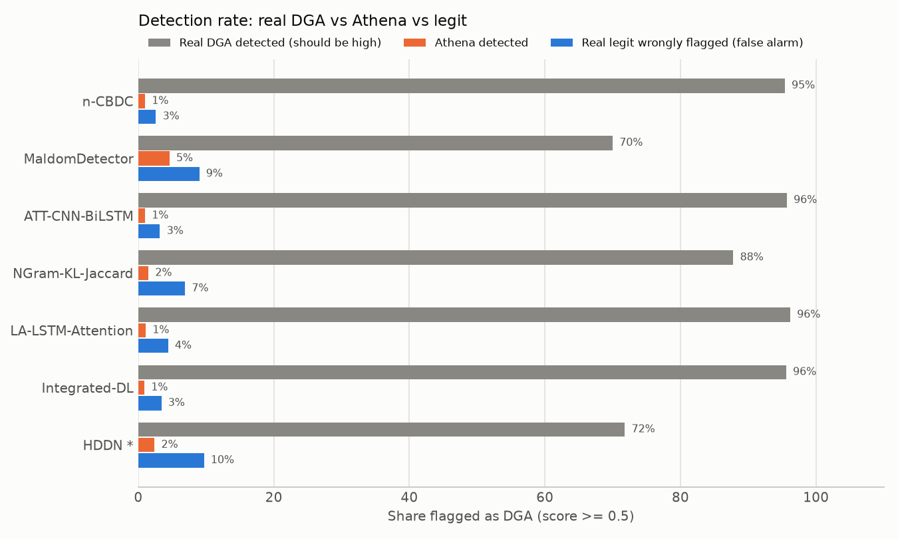
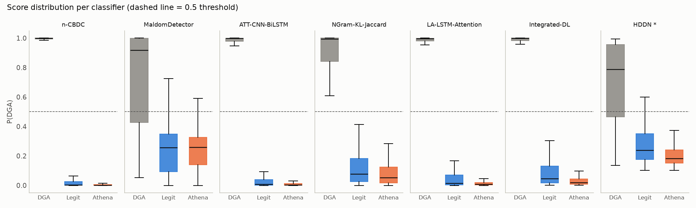
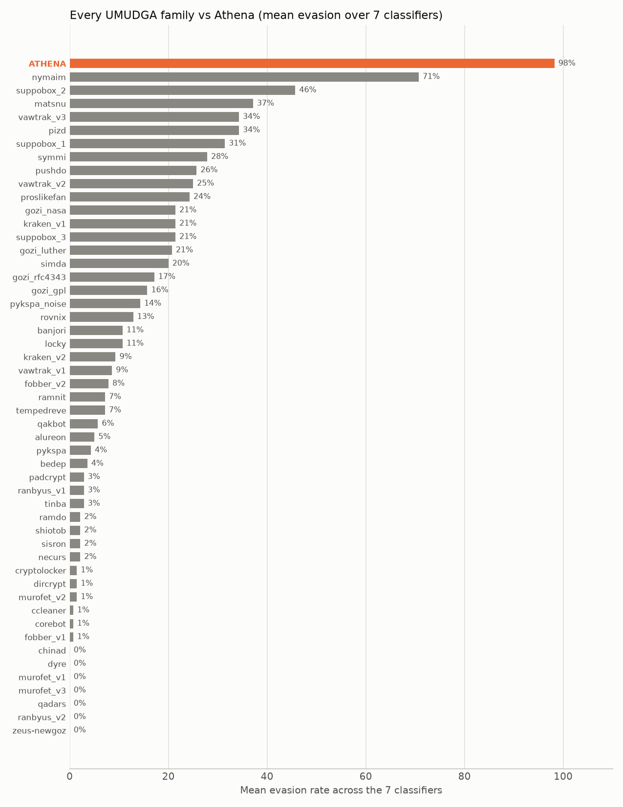
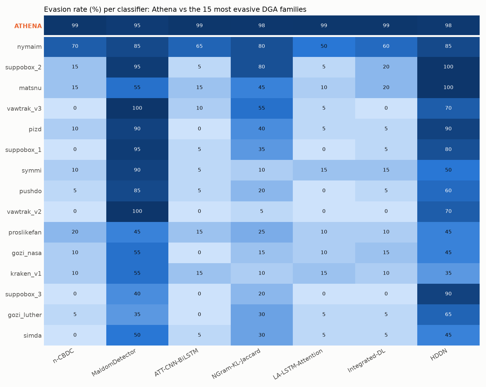

# Evasion rate: real DGA domains vs Athena

Real DGA: 1,000 names (20 from each of 50 UMUDGA families) from the held-out test split. Athena: 1000 names from `scores.csv`. Evasion = share scored < 0.5 (not flagged).

## Per classifier

| Model | Real DGA evasion | Athena evasion | Difference | Mean score: real DGA | Mean score: Athena |
|---|---|---|---|---|---|
| n-CBDC | 4.6% | **99.0%** | +94.4 pts | 0.943 | 0.019 |
| MaldomDetector | 30.0% | **95.4%** | +65.4 pts | 0.737 | 0.249 |
| ATT-CNN-BiLSTM | 4.3% | **99.0%** | +94.7 pts | 0.938 | 0.026 |
| NGram-KL-Jaccard | 12.2% | **98.5%** | +86.3 pts | 0.860 | 0.092 |
| LA-LSTM-Attention | 3.8% | **98.9%** | +95.1 pts | 0.944 | 0.030 |
| Integrated-DL | 4.4% | **99.1%** | +94.7 pts | 0.938 | 0.047 |
| HDDN * | 28.2% | **97.6%** | +69.4 pts | 0.703 | 0.214 |
| Majority vote | 5.7% | **99.6%** | +93.9 pts | - | - |

\* still smoke-test weights at run time (full training not finished).

## Detection rate (share flagged as DGA)

| Model | Real DGA detected | Athena detected | Legit wrongly flagged | AUC: real DGA vs legit | AUC: Athena vs legit |
|---|---|---|---|---|---|
| n-CBDC | 95.4% | **1.0%** | 2.6% | 0.994 | **0.397** |
| MaldomDetector | 70.0% | **4.6%** | 9.0% | 0.889 | **0.504** |
| ATT-CNN-BiLSTM | 95.7% | **1.0%** | 3.2% | 0.993 | **0.406** |
| NGram-KL-Jaccard | 87.8% | **1.5%** | 6.9% | 0.967 | **0.427** |
| LA-LSTM-Attention | 96.2% | **1.1%** | 4.4% | 0.993 | **0.390** |
| Integrated-DL | 95.6% | **0.9%** | 3.4% | 0.991 | **0.327** |
| HDDN * | 71.8% | **2.4%** | 9.7% | 0.893 | **0.336** |

AUC 1.0 = the model fully separates that set from real legit; 0.5 = it cannot tell them apart; below 0.5 = it scores that set as *more* legit than real legit names.

## Validation: are the classifiers really good on actual DGA?

Full held-out test set (100,000 real DGA + 100,000 legit, from `results.json`) next to this run's 5,000-name sample. If the sample detection rate matches the full-test recall, the scoring here is consistent.

| Model | Full test: precision | Full test: recall (detection) | Full test: F1 | Full test: ROC-AUC | Full test: FPR | This sample: detection | Gap |
|---|---|---|---|---|---|---|---|
| n-CBDC | 0.9677 | 94.7% | 0.9572 | 0.9919 | 3.16% | 95.4% | +0.7 pts |
| MaldomDetector | 0.8825 | 71.1% | 0.7878 | 0.8894 | 9.47% | 70.0% | -1.1 pts |
| ATT-CNN-BiLSTM | 0.9639 | 94.9% | 0.9564 | 0.9914 | 3.55% | 95.7% | +0.8 pts |
| NGram-KL-Jaccard | 0.9326 | 87.0% | 0.9003 | 0.9652 | 6.29% | 87.8% | +0.8 pts |
| LA-LSTM-Attention | 0.9522 | 95.2% | 0.9520 | 0.9900 | 4.78% | 96.2% | +1.0 pts |
| Integrated-DL | 0.9558 | 94.6% | 0.9507 | 0.9882 | 4.37% | 95.6% | +1.0 pts |
| HDDN * | 0.8765 | 70.0% | 0.7786 | 0.8858 | 9.73% | 71.8% | +1.8 pts |

## Athena vs every DGA family

Athena's mean evasion over the 7 classifiers is **98.2%**, higher than **50 of 50** real DGA families.

| Rank | Family | Mean evasion (7 models) |
|---|---|---|
| 1 | **ATHENA** | **98.2%** |
| 2 | nymaim | 70.7% |
| 3 | suppobox_2 | 45.7% |
| 4 | matsnu | 37.1% |
| 5 | vawtrak_v3 | 34.3% |
| 6 | pizd | 34.3% |
| 7 | suppobox_1 | 31.4% |
| 8 | symmi | 27.9% |
| 9 | pushdo | 25.7% |
| 10 | vawtrak_v2 | 25.0% |
| 11 | proslikefan | 24.3% |
| 12 | gozi_nasa | 21.4% |
| 13 | kraken_v1 | 21.4% |
| 14 | suppobox_3 | 21.4% |
| 15 | gozi_luther | 20.7% |
| 16 | simda | 20.0% |
| 17 | gozi_rfc4343 | 17.1% |
| 18 | gozi_gpl | 15.7% |
| 19 | pykspa_noise | 14.3% |
| 20 | rovnix | 12.9% |
| 21 | banjori | 10.7% |
| 22 | locky | 10.7% |
| 23 | kraken_v2 | 9.3% |
| 24 | vawtrak_v1 | 8.6% |
| 25 | fobber_v2 | 7.9% |
| 26 | ramnit | 7.1% |
| 27 | tempedreve | 7.1% |
| 28 | qakbot | 5.7% |
| 29 | alureon | 5.0% |
| 30 | pykspa | 4.3% |
| 31 | bedep | 3.6% |
| 32 | padcrypt | 2.9% |
| 33 | ranbyus_v1 | 2.9% |
| 34 | tinba | 2.9% |
| 35 | ramdo | 2.1% |
| 36 | shiotob | 2.1% |
| 37 | sisron | 2.1% |
| 38 | necurs | 2.1% |
| 39 | cryptolocker | 1.4% |
| 40 | dircrypt | 1.4% |
| 41 | murofet_v2 | 1.4% |
| 42 | ccleaner | 0.7% |
| 43 | corebot | 0.7% |
| 44 | fobber_v1 | 0.7% |
| 45 | chinad | 0.0% |
| 46 | dyre | 0.0% |
| 47 | murofet_v1 | 0.0% |
| 48 | murofet_v3 | 0.0% |
| 49 | qadars | 0.0% |
| 50 | ranbyus_v2 | 0.0% |
| 51 | zeus-newgoz | 0.0% |

