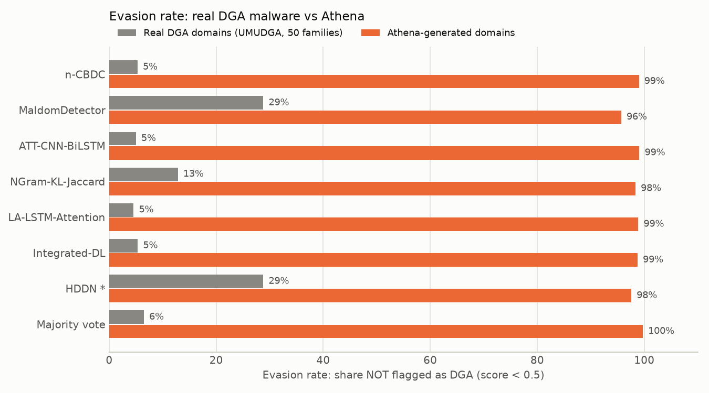
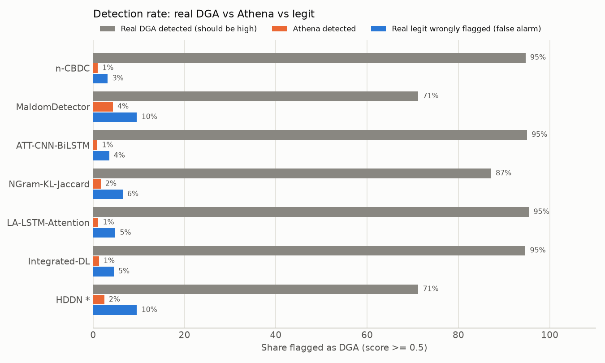
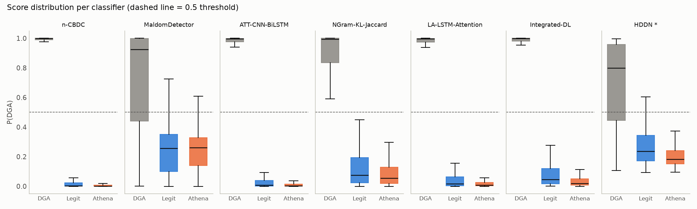
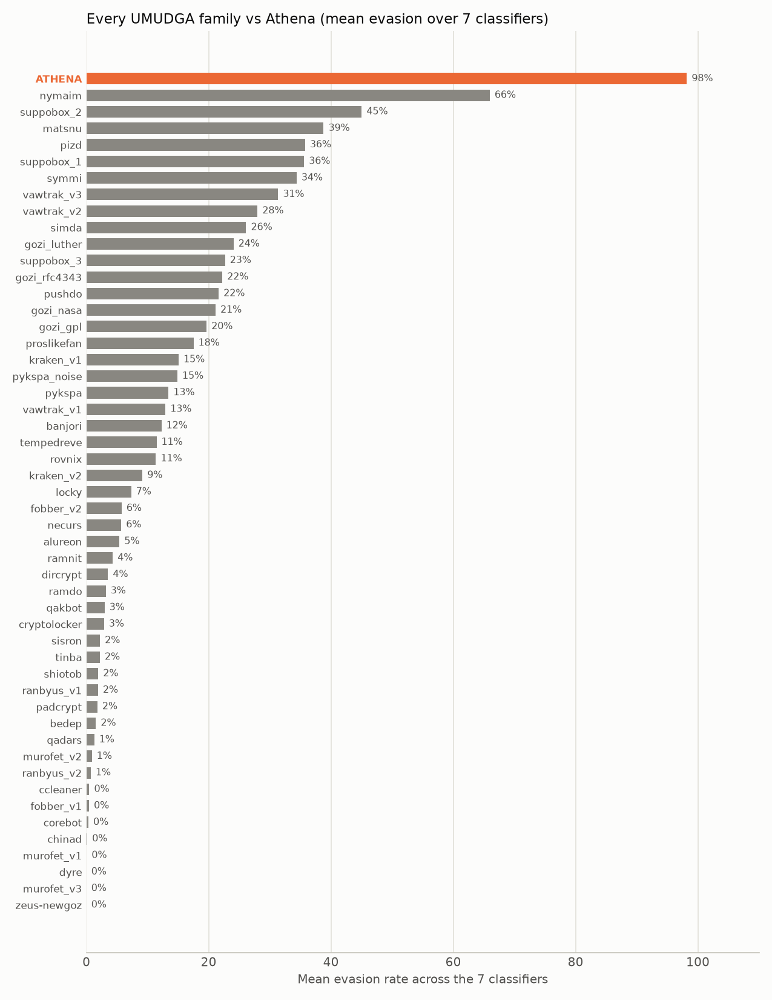
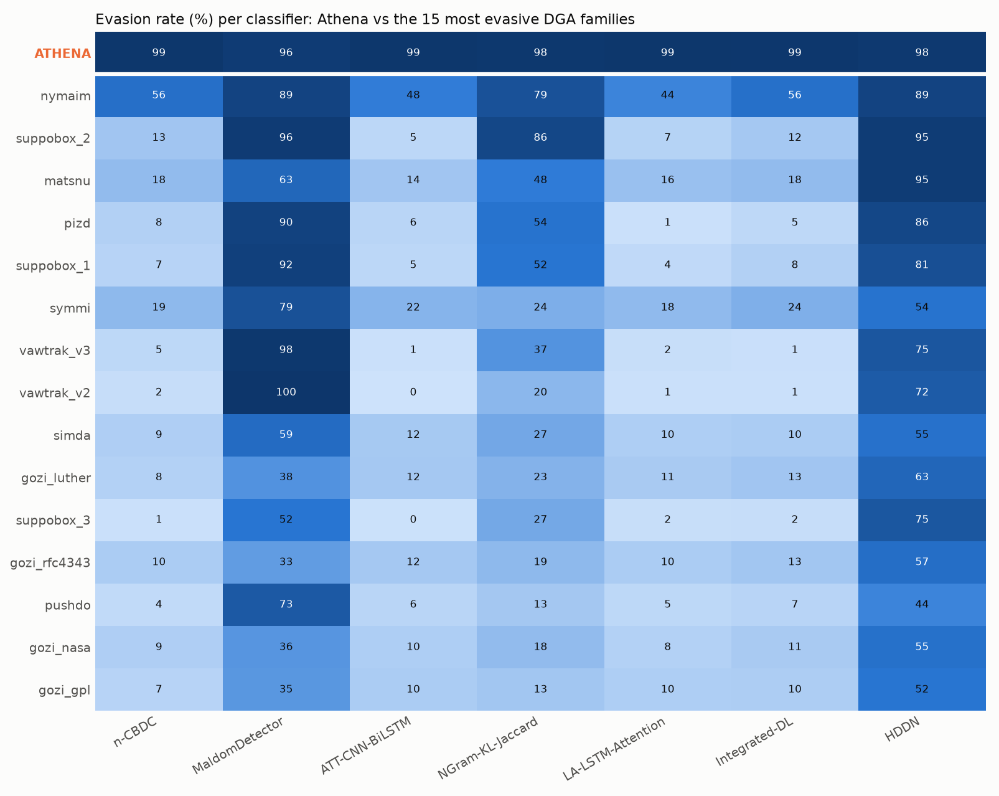

# Evasion rate: real DGA domains vs Athena

Real DGA: 35,000 names (700 from each of 50 UMUDGA families) from the held-out test split. Athena: 35000 names from `scores.csv`. Evasion = share scored < 0.5 (not flagged).

## Per classifier

| Model | Real DGA evasion | Athena evasion | Difference | Mean score: real DGA | Mean score: Athena |
|---|---|---|---|---|---|
| n-CBDC | 5.3% | **99.0%** | +93.7 pts | 0.935 | 0.024 |
| MaldomDetector | 28.8% | **95.7%** | +66.9 pts | 0.744 | 0.250 |
| ATT-CNN-BiLSTM | 5.0% | **99.1%** | +94.1 pts | 0.932 | 0.027 |
| NGram-KL-Jaccard | 12.8% | **98.3%** | +85.5 pts | 0.855 | 0.097 |
| LA-LSTM-Attention | 4.6% | **98.9%** | +94.3 pts | 0.935 | 0.036 |
| Integrated-DL | 5.3% | **98.7%** | +93.4 pts | 0.932 | 0.053 |
| HDDN * | 28.8% | **97.6%** | +68.8 pts | 0.699 | 0.213 |
| Majority vote | 6.5% | **99.7%** | +93.2 pts | - | - |

\* still smoke-test weights at run time (full training not finished).

## Detection rate (share flagged as DGA)

| Model | Real DGA detected | Athena detected | Legit wrongly flagged | AUC: real DGA vs legit | AUC: Athena vs legit |
|---|---|---|---|---|---|
| n-CBDC | 94.7% | **1.0%** | 3.2% | 0.992 | **0.421** |
| MaldomDetector | 71.2% | **4.3%** | 9.6% | 0.889 | **0.502** |
| ATT-CNN-BiLSTM | 95.0% | **0.9%** | 3.5% | 0.992 | **0.418** |
| NGram-KL-Jaccard | 87.2% | **1.7%** | 6.5% | 0.965 | **0.440** |
| LA-LSTM-Attention | 95.4% | **1.1%** | 4.8% | 0.990 | **0.412** |
| Integrated-DL | 94.7% | **1.3%** | 4.5% | 0.988 | **0.348** |
| HDDN * | 71.2% | **2.4%** | 9.6% | 0.887 | **0.346** |

AUC 1.0 = the model fully separates that set from real legit; 0.5 = it cannot tell them apart; below 0.5 = it scores that set as *more* legit than real legit names.

## Validation: are the classifiers really good on actual DGA?

Full held-out test set (100,000 real DGA + 100,000 legit, from `results.json`) next to this run's 5,000-name sample. If the sample detection rate matches the full-test recall, the scoring here is consistent.

| Model | Full test: precision | Full test: recall (detection) | Full test: F1 | Full test: ROC-AUC | Full test: FPR | This sample: detection | Gap |
|---|---|---|---|---|---|---|---|
| n-CBDC | 0.9677 | 94.7% | 0.9572 | 0.9919 | 3.16% | 94.7% | +0.0 pts |
| MaldomDetector | 0.8825 | 71.1% | 0.7878 | 0.8894 | 9.47% | 71.2% | +0.1 pts |
| ATT-CNN-BiLSTM | 0.9639 | 94.9% | 0.9564 | 0.9914 | 3.55% | 95.0% | +0.1 pts |
| NGram-KL-Jaccard | 0.9326 | 87.0% | 0.9003 | 0.9652 | 6.29% | 87.2% | +0.1 pts |
| LA-LSTM-Attention | 0.9522 | 95.2% | 0.9520 | 0.9900 | 4.78% | 95.4% | +0.3 pts |
| Integrated-DL | 0.9558 | 94.6% | 0.9507 | 0.9882 | 4.37% | 94.7% | +0.1 pts |
| HDDN * | 0.8765 | 70.0% | 0.7786 | 0.8858 | 9.73% | 71.2% | +1.2 pts |

## Athena vs every DGA family

Athena's mean evasion over the 7 classifiers is **98.2%**, higher than **50 of 50** real DGA families.

| Rank | Family | Mean evasion (7 models) |
|---|---|---|
| 1 | **ATHENA** | **98.2%** |
| 2 | nymaim | 66.0% |
| 3 | suppobox_2 | 45.0% |
| 4 | matsnu | 38.8% |
| 5 | pizd | 35.8% |
| 6 | suppobox_1 | 35.6% |
| 7 | symmi | 34.4% |
| 8 | vawtrak_v3 | 31.3% |
| 9 | vawtrak_v2 | 28.0% |
| 10 | simda | 26.1% |
| 11 | gozi_luther | 24.1% |
| 12 | suppobox_3 | 22.7% |
| 13 | gozi_rfc4343 | 22.2% |
| 14 | pushdo | 21.6% |
| 15 | gozi_nasa | 21.1% |
| 16 | gozi_gpl | 19.7% |
| 17 | proslikefan | 17.5% |
| 18 | kraken_v1 | 15.1% |
| 19 | pykspa_noise | 14.9% |
| 20 | pykspa | 13.4% |
| 21 | vawtrak_v1 | 12.9% |
| 22 | banjori | 12.3% |
| 23 | tempedreve | 11.5% |
| 24 | rovnix | 11.4% |
| 25 | kraken_v2 | 9.2% |
| 26 | locky | 7.3% |
| 27 | fobber_v2 | 5.8% |
| 28 | necurs | 5.7% |
| 29 | alureon | 5.4% |
| 30 | ramnit | 4.3% |
| 31 | dircrypt | 3.5% |
| 32 | ramdo | 3.2% |
| 33 | qakbot | 3.0% |
| 34 | cryptolocker | 2.9% |
| 35 | sisron | 2.2% |
| 36 | tinba | 2.2% |
| 37 | shiotob | 1.9% |
| 38 | ranbyus_v1 | 1.9% |
| 39 | padcrypt | 1.8% |
| 40 | bedep | 1.6% |
| 41 | qadars | 1.3% |
| 42 | murofet_v2 | 0.9% |
| 43 | ranbyus_v2 | 0.7% |
| 44 | ccleaner | 0.5% |
| 45 | fobber_v1 | 0.4% |
| 46 | corebot | 0.3% |
| 47 | chinad | 0.1% |
| 48 | murofet_v1 | 0.1% |
| 49 | dyre | 0.0% |
| 50 | murofet_v3 | 0.0% |
| 51 | zeus-newgoz | 0.0% |

