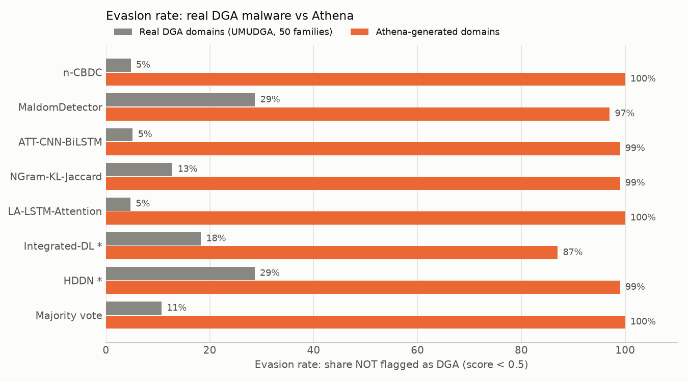
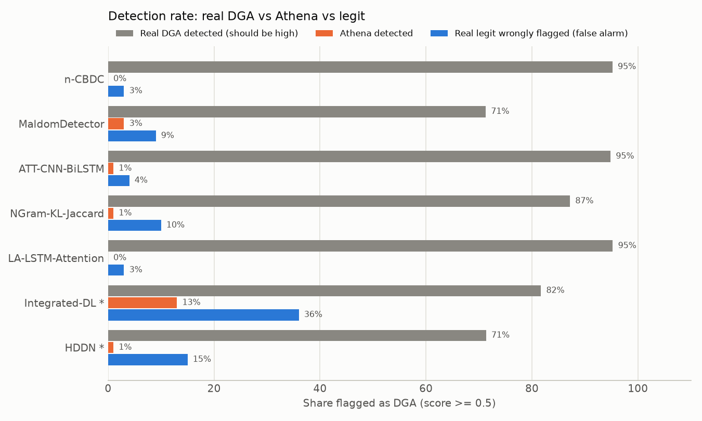
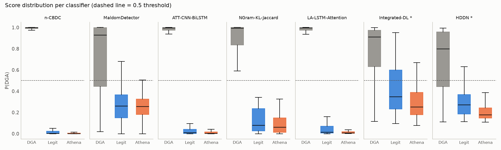
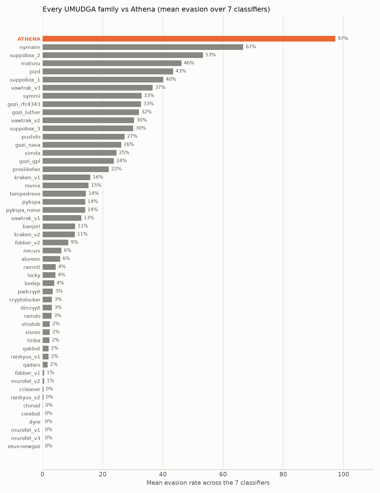
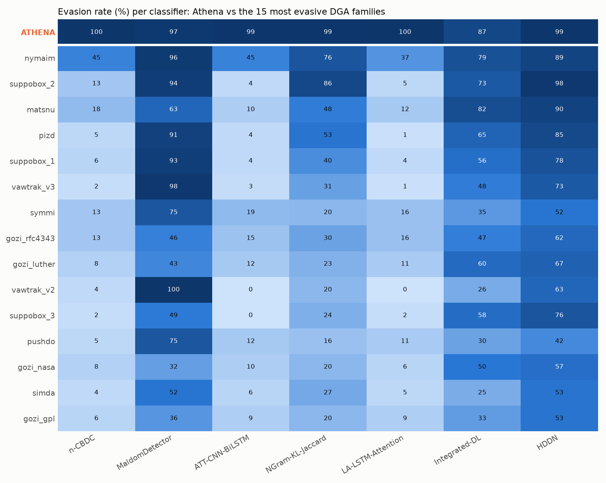

# Evasion rate: real DGA domains vs Athena

Real DGA: 5,000 names (100 from each of 50 UMUDGA families) from the held-out test split. Athena: 100 names from `scores.csv`. Evasion = share scored < 0.5 (not flagged).

## Per classifier

| Model | Real DGA evasion | Athena evasion | Difference | Mean score: real DGA | Mean score: Athena |
|---|---|---|---|---|---|
| n-CBDC | 4.8% | **100.0%** | +95.2 pts | 0.937 | 0.018 |
| MaldomDetector | 28.7% | **97.0%** | +68.3 pts | 0.746 | 0.239 |
| ATT-CNN-BiLSTM | 5.2% | **99.0%** | +93.8 pts | 0.930 | 0.026 |
| NGram-KL-Jaccard | 12.8% | **99.0%** | +86.2 pts | 0.856 | 0.104 |
| LA-LSTM-Attention | 4.7% | **100.0%** | +95.3 pts | 0.935 | 0.027 |
| Integrated-DL * | 18.3% | **87.0%** | +68.7 pts | 0.783 | 0.300 |
| HDDN * | 28.7% | **99.0%** | +70.3 pts | 0.699 | 0.210 |
| Majority vote | 10.7% | **100.0%** | +89.3 pts | - | - |

\* still smoke-test weights at run time (full training not finished).

## Detection rate (share flagged as DGA)

| Model | Real DGA detected | Athena detected | Legit wrongly flagged | AUC: real DGA vs legit | AUC: Athena vs legit |
|---|---|---|---|---|---|
| n-CBDC | 95.2% | **0.0%** | 3.0% | 0.991 | **0.380** |
| MaldomDetector | 71.3% | **3.0%** | 9.0% | 0.879 | **0.476** |
| ATT-CNN-BiLSTM | 94.8% | **1.0%** | 4.0% | 0.992 | **0.409** |
| NGram-KL-Jaccard | 87.2% | **1.0%** | 10.0% | 0.957 | **0.434** |
| LA-LSTM-Attention | 95.3% | **0.0%** | 3.0% | 0.993 | **0.402** |
| Integrated-DL * | 81.7% | **13.0%** | 36.0% | 0.843 | **0.340** |
| HDDN * | 71.3% | **1.0%** | 15.0% | 0.862 | **0.284** |

AUC 1.0 = the model fully separates that set from real legit; 0.5 = it cannot tell them apart; below 0.5 = it scores that set as *more* legit than real legit names.

## Validation: are the classifiers really good on actual DGA?

Full held-out test set (100,000 real DGA + 100,000 legit, from `results.json`) next to this run's 5,000-name sample. If the sample detection rate matches the full-test recall, the scoring here is consistent.

| Model | Full test: precision | Full test: recall (detection) | Full test: F1 | Full test: ROC-AUC | Full test: FPR | This sample: detection | Gap |
|---|---|---|---|---|---|---|---|
| n-CBDC | 0.9677 | 94.7% | 0.9572 | 0.9919 | 3.16% | 95.2% | +0.5 pts |
| MaldomDetector | 0.8825 | 71.1% | 0.7878 | 0.8894 | 9.47% | 71.3% | +0.1 pts |
| ATT-CNN-BiLSTM | 0.9639 | 94.9% | 0.9564 | 0.9914 | 3.55% | 94.8% | -0.1 pts |
| NGram-KL-Jaccard | 0.9326 | 87.0% | 0.9003 | 0.9652 | 6.29% | 87.2% | +0.2 pts |
| LA-LSTM-Attention | 0.9522 | 95.2% | 0.9520 | 0.9900 | 4.78% | 95.3% | +0.1 pts |
| Integrated-DL * | 0.7641 | 81.5% | 0.7886 | 0.8764 | 24.78% | 81.7% | +0.2 pts |
| HDDN * | 0.8765 | 70.0% | 0.7786 | 0.8858 | 9.73% | 71.3% | +1.3 pts |

## Athena vs every DGA family

Athena's mean evasion over the 7 classifiers is **97.3%**, higher than **50 of 50** real DGA families.

| Rank | Family | Mean evasion (7 models) |
|---|---|---|
| 1 | **ATHENA** | **97.3%** |
| 2 | nymaim | 66.7% |
| 3 | suppobox_2 | 53.3% |
| 4 | matsnu | 46.1% |
| 5 | pizd | 43.4% |
| 6 | suppobox_1 | 40.1% |
| 7 | vawtrak_v3 | 36.6% |
| 8 | symmi | 32.9% |
| 9 | gozi_rfc4343 | 32.7% |
| 10 | gozi_luther | 32.0% |
| 11 | vawtrak_v2 | 30.4% |
| 12 | suppobox_3 | 30.1% |
| 13 | pushdo | 27.3% |
| 14 | gozi_nasa | 26.1% |
| 15 | simda | 24.6% |
| 16 | gozi_gpl | 23.7% |
| 17 | proslikefan | 22.0% |
| 18 | kraken_v1 | 15.9% |
| 19 | rovnix | 15.3% |
| 20 | tempedreve | 14.4% |
| 21 | pykspa | 14.1% |
| 22 | pykspa_noise | 14.1% |
| 23 | vawtrak_v1 | 12.9% |
| 24 | banjori | 10.9% |
| 25 | kraken_v2 | 10.7% |
| 26 | fobber_v2 | 8.6% |
| 27 | necurs | 6.3% |
| 28 | alureon | 5.9% |
| 29 | ramnit | 4.4% |
| 30 | locky | 4.3% |
| 31 | bedep | 3.9% |
| 32 | padcrypt | 3.4% |
| 33 | cryptolocker | 3.1% |
| 34 | dircrypt | 3.1% |
| 35 | ramdo | 3.0% |
| 36 | shiotob | 2.4% |
| 37 | sisron | 2.4% |
| 38 | tinba | 2.3% |
| 39 | qakbot | 2.0% |
| 40 | ranbyus_v1 | 2.0% |
| 41 | qadars | 1.7% |
| 42 | fobber_v1 | 0.6% |
| 43 | murofet_v2 | 0.6% |
| 44 | ccleaner | 0.3% |
| 45 | ranbyus_v2 | 0.3% |
| 46 | chinad | 0.1% |
| 47 | corebot | 0.0% |
| 48 | dyre | 0.0% |
| 49 | murofet_v1 | 0.0% |
| 50 | murofet_v3 | 0.0% |
| 51 | zeus-newgoz | 0.0% |

