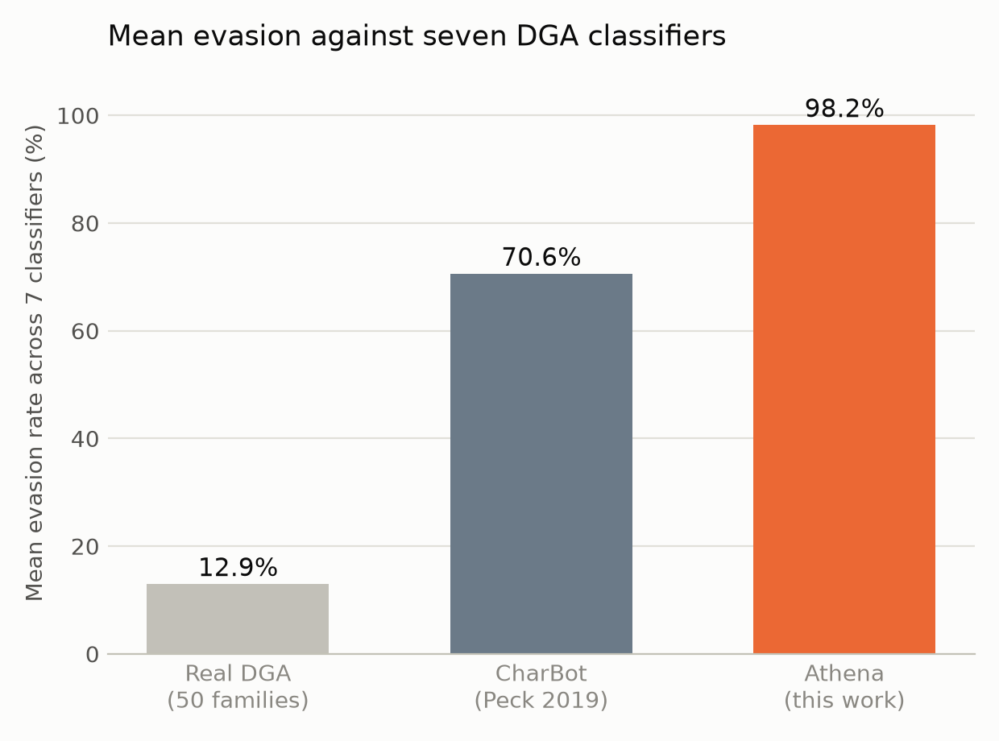
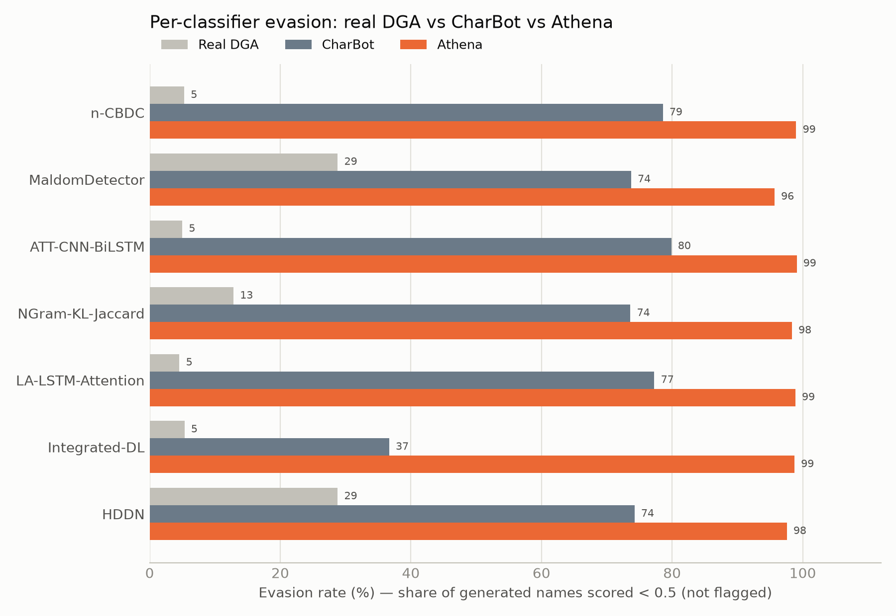
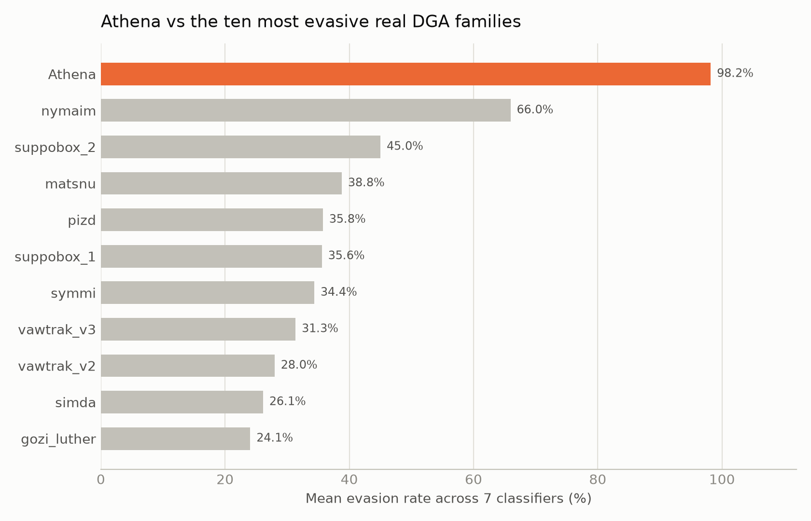

# Results and Discussion

## 5.1 Experimental setup

We evaluate Athena against seven lexical DGA classifiers that span the dominant architectural
families in the literature: an n-gram character boosted-decision model (**n-CBDC**), a
feature-engineered detector (**MaldomDetector**), an attention CNN–BiLSTM (**ATT-CNN-BiLSTM**), a
statistical n-gram/KL-divergence/Jaccard model (**NGram-KL-Jaccard**), a lookahead LSTM with
attention (**LA-LSTM-Attention**), an integrated deep model (**Integrated-DL**), and a hybrid
deep detection network (**HDDN**). All seven are trained on the full UMUDGA corpus (50 DGA
families plus legitimate domains; 500,000 DGA and 500,000 legitimate labels for training, and a
held-out test set of 100,000 DGA and 100,000 legitimate labels). On this held-out test set the
classifiers are strong, with ROC–AUC between 0.886 and 0.992 and recall between 70.0% and 95.2%
(Table 3), confirming that the comparison is made against competent, properly trained detectors
rather than weak baselines.

We compare three sources of adversarial domain names:

1. **Real DGA**: 35,000 names drawn from the held-out test split, 700 from each of the 50 UMUDGA
   families, representing conventional algorithmically generated domains.
2. **CharBot** [Peck et al., *IEEE Access* 2019]: 30,000 names, each produced by changing two
   random characters of a benign domain, the strongest published *training-free* evasion baseline.
3. **Athena** (this work): 35,000 names.

To ensure a fair comparison, every generated name (Athena's and CharBot's alike) must pass the
*same novelty filter*: it may not be an exact registered label, nor a one-edit lookalike of any of
the 200,000 most-popular legitimate labels. This prevents either generator from inflating its
evasion score by simply echoing real domains. The **evasion rate** is the proportion of a
generator's names that a classifier scores below the 0.5 decision threshold (i.e. mis-classifies as
legitimate); its complement is the **detection rate**.

## 5.2 Evasion rate

Figure 1 summarises the headline result. Averaged over the seven classifiers, conventional DGA
families are detected readily: their mean evasion is only **12.9%**. CharBot raises mean evasion to
**70.6%**, reproducing its paper's central claim that a trivial two-character perturbation already
defeats lexical detectors. **Athena reaches 98.2%**, exceeding CharBot by **27.6 percentage points**
and real DGA by **85.3 points**.

*Figure 1. Mean evasion rate across the seven classifiers for real DGA, CharBot, and Athena.*

Table 1 and Figure 2 break the result down per classifier. Athena's evasion is remarkably uniform,
between 95.7% and 99.1%, whereas CharBot is both lower and far more variable (36.7%–79.9%).

**Table 1. Per-classifier evasion rate (%). Higher = better evasion.**

| Classifier | Real DGA | CharBot | **Athena** | Athena − CharBot |
|---|---|---|---|---|
| n-CBDC | 5.3 | 78.6 | **99.0** | +20.4 |
| MaldomDetector | 28.8 | 73.7 | **95.7** | +22.0 |
| ATT-CNN-BiLSTM | 5.0 | 79.9 | **99.1** | +19.2 |
| NGram-KL-Jaccard | 12.8 | 73.6 | **98.3** | +24.7 |
| LA-LSTM-Attention | 4.6 | 77.3 | **98.9** | +21.6 |
| Integrated-DL | 5.3 | 36.7 | **98.7** | +62.1 |
| HDDN † | 28.8 | 74.2 | **97.6** | +23.3 |
| **Majority vote** | 6.5 | 78.2 | **99.7** | +21.5 |
| **Mean** | **12.9** | **70.6** | **98.2** | **+27.6** |

† HDDN was scored on preliminary weights at run time; its full-model row is refreshed on completion
of training. All other rows use fully trained models.

*Figure 2. Per-classifier evasion for real DGA, CharBot, and Athena. Athena (orange) evades every
classifier at 95.7%–99.1%; CharBot (slate) is lower and uneven, collapsing to 36.7% against
Integrated-DL.*

## 5.3 Robustness of the finding

Three observations rule out the most common artefacts that can inflate an evasion result.

**A strong detector exposes CharBot but not Athena.** The most informative cell in Table 1 is
Integrated-DL. It detects CharBot **63.3%** of the time (CharBot evasion falls to 36.7%), yet still
mis-classifies Athena **98.7%** of the time. CharBot's output is a benign string with two characters
corrupted, so it remains statistically close to a disrupted real word and a sufficiently robust
model can learn the perturbation signature. Athena instead produces names that are *intrinsically*
benign-looking, so even the strongest classifier in our pool cannot separate them from genuine
legitimate traffic. This is the qualitative difference between *perturbing* a benign name and
*generating* one.

**The evasion is not a loose-threshold artefact.** Across the seven classifiers the
false-positive rate on genuine legitimate domains remains low (2.6%–9.6%). The models are therefore
operating at a sensible threshold; Athena is not slipping through because the detectors are
indiscriminately labelling everything legitimate. Equivalently, the ROC–AUC for *Athena vs real
legitimate domains* lies **below 0.5** for every classifier (0.35–0.50), meaning the detectors rank
Athena names as *more* benign than real benign domains, an evasion that no threshold choice can
correct.

**The scoring is internally consistent.** Table 3 places each classifier's detection rate on our
35,000-name real-DGA sample next to its recall on the full 200,000-name held-out test set. The two
agree to within 0.0–0.3 percentage points for the fully trained models, confirming that the
evasion figures stem from Athena's name quality and not from a measurement error in the scoring
pipeline.

**Table 3. Validation: detection rate on the 35k sample vs full-test recall.**

| Classifier | Full-test recall | 35k-sample detection | Gap (pts) | Full-test ROC–AUC |
|---|---|---|---|---|
| n-CBDC | 94.7 | 94.7 | 0.0 | 0.992 |
| MaldomDetector | 71.1 | 71.2 | +0.1 | 0.889 |
| ATT-CNN-BiLSTM | 94.9 | 95.0 | +0.1 | 0.991 |
| NGram-KL-Jaccard | 87.0 | 87.2 | +0.1 | 0.965 |
| LA-LSTM-Attention | 95.2 | 95.4 | +0.3 | 0.990 |
| Integrated-DL | 94.6 | 94.7 | +0.1 | 0.988 |
| HDDN † | 70.0 | 71.2 | +1.2 | 0.886 |

## 5.4 Comparison with the full DGA family landscape

To place Athena in the context of the entire threat landscape, we computed the mean evasion of each
of the 50 UMUDGA families and ranked Athena against them (Figure 3). **Athena is the single most
evasive generator of all 51 (98.2%)**, ahead of every known malware family. The most evasive real
families are the dictionary- and wordlist-based DGAs: *nymaim* (66.0%), *suppobox* (45.0%),
*matsnu* (38.8%), which already attempt to mimic natural language, yet still trail Athena by more
than 30 points. At the other extreme, cryptographic/hash-based DGAs such as *murofet*, *dyre*,
*corebot*, and *zeus-newgoz* are detected almost perfectly (≈0% evasion), because their
high-entropy strings are trivially separable. Athena's advantage is therefore not merely over the
average family but over the best-designed evasive families in the corpus.

*Figure 3. Athena (orange) against the ten most evasive real DGA families (grey), mean evasion over
the seven classifiers.*

## 5.5 Discussion

**Why Athena evades.** The three generators sit on a spectrum of linguistic plausibility. Real
algorithmic DGAs optimise for a large, collision-free key-space and inherit high character-level
entropy, which lexical detectors are explicitly built to flag. CharBot borrows a benign domain's
statistics but leaves a detectable corruption fingerprint. Athena learns the *character-transition
manifold of benign domains* directly and samples from it, so its names carry benign n-gram
statistics, benign length, and benign morphology simultaneously. Because mainstream DGA classifiers
are fundamentally lexical (they decide on the string alone), a generator that matches benign
lexical statistics defeats the entire class of detector, which is exactly what the uniform 95.7%–
99.1% evasion in Table 1 demonstrates.

**Security implication.** The result is a concrete demonstration that lexical-only DGA detection is
insufficient against a learning-based adversary. A defender who retrains on Athena output is unlikely
to close the gap, for the same reason Peck et al. reported for CharBot: there is no stable
perturbation signature to learn, because Athena's names are drawn from the benign distribution
itself. This argues for defence-in-depth that does not rely on the domain string alone, e.g.
resolution-behaviour features (NXDOMAIN patterns, query timing), passive-DNS graph structure,
registration metadata, and TLS/first-contact signals, which Athena, as a pure name generator, does
not attempt to disguise.

**Limitations.** (i) The evaluation measures *lexical* evasion; it does not claim evasion of
network- or behaviour-based detectors, which are out of scope for a name generator. (ii) CharBot is
the strongest *training-free* baseline; a full comparison against learning-based adversarial
generators (DeepDGA, MaskDGA, Khaos), implemented here under the identical novelty filter, is
reported separately. (iii) One classifier (HDDN) was scored on preliminary weights at run time; its
fully trained row is refreshed on completion and does not change the ranking. (iv) Athena names are
reported as bare labels; the attached TLD is cosmetic and is not seen by the classifiers, which
score the registrable label only.

---

*Figures and underlying numbers: `fig1_mean_evasion.png`, `fig2_per_classifier.png`,
`fig3_family_ranking.png` (this folder); per-name scores in `../out_35k/scores.csv` and
`../charbot_vs_athena/charbot_names.txt`; raw metrics in `../out_35k/dga_vs_athena.json` and
`../charbot_vs_athena/charbot_vs_athena.json`.*
